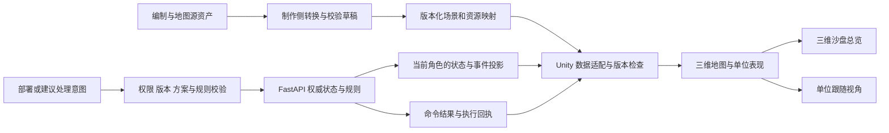

# Unity 地图与战斗视角

修订日期：2026-10-31。根据三项目融合后的 [01 产品需求](01产品需求.md) 和 [02 仿真规则与参数](02仿真规则与参数.md) 更新。Unity、三维沙盘总览与单位跟随已确认；具体版本、发布形态、渲染管线、UI 技术和相机参数待确认，Unity 工程尚未创建。

本文件定义目标客户端的场景、相机、资产适配和状态表现。首版主流程、后续候选及设计参数分别标注；源项目存在的编辑器、指挥或分析能力不代表已经迁移。页面布局见 [交互与视觉设计：页面结构与完整线框](04交互与视觉设计.md#wireframes)，游戏规则及参数确认状态以规则文档和决策台账为准。

## 文档导航

- [1. 决策与适用范围](#section-01)
- [2. Unity 的职责](#section-02)
- [3. 两种观察视角](#section-03)
- [4. 状态、坐标与表现](#section-04)
- [5. 工程与平台方案](#section-05)
- [6. 官方资料与核对边界](#section-06)
- [7. 实施与验收入口](#section-07)

重点阅读：[三项目功能映射](#feature-mapping)、[资产与场景接入](#asset-adaptation)、[角色与按钮权限](#role-interaction)、[表现参数](#presentation-parameters)、[融合验收](#integration-acceptance)。

## 1. 决策与适用范围

修订日期：2026-10-31。用户明确采用 Unity 完成地图与战斗视角，并选择“三维沙盘总览，加单位跟随视角”。这两项为已确认需求；本文件中的实现方案与参数按各节标注，不表示 Unity 工程已创建或验收。

本文件负责定义 Unity 地图表现、相机模式、数据边界和迁移验收。它替代此前“Vue/SVG 继续承担正式地图”“不引入地图引擎”“首版只提供二维画面”及排除三维引擎的约定。原有二维业务坐标、道路与航线、视野、抽象对抗和仿真步规则继续有效；三维画面不自动增加高度、弹道或物理碰撞结算规则。

| 内容 | 状态 |
| --- | --- |
| 地图与战斗表现使用 Unity | 用户已确认 |
| 三维沙盘总览、单位跟随视角 | 用户已确认 |
| 本机虚构数字沙盘、三角色权限、后端权威结算 | 沿用既有要求 |
| Unity 具体版本、渲染管线、UI 技术及资源规格 | 待确认 |
| 独立 Windows 客户端或 Unity Web 嵌入现有网页 | 待确认；本次不默认取消 Vue 业务面板或强制保留网页外壳 |
| 相机投影、移动/旋转/缩放输入、距离和角度限制 | 待确认 |
| OpenHarmony 承载方式与兼容性 | 待设备、版本及实机验证 |

### 1.1 三项目功能映射

| 能力来源 | Unity 客户端承担的内容 | 服务端或制作侧承担的内容 | 需求与范围 |
| --- | --- | --- | --- |
| 当前沙盘地图、兵营和三兵种 | 三维地形、部署预览、单位、路线、探索状态、任务及交战结果 | 部署校验、任务、行动、视野、资源和评分 | PRD-01～23；首版已有需求 |
| Army_Editor 编制树、兵牌与装备 | 通过模板与实例映射显示单位、图标、配置数量和允许的属性 | 组织树校验、引用、复制身份、统计与实例展开 | PRD-24、25；完整资产编辑为后续候选 |
| Army_Editor 图层、道路与对象 | 使用转换后的地图与资源清单，显示道路、区域、设施和任务标记 | 转换源格式、稳定地形 ID、坐标、连接与场景版本 | PRD-26、27；首版固定场景，完整编辑器为后续候选 |
| Gentactix-DSH 命令与回执 | 显示草稿、预览、已采用计划、执行状态及失败原因 | 校验权限、版本、方案资格、资源、幂等及实际执行事实 | PRD-28、32、35；基础命令边界保留，队列增强待设计 |
| Gentactix-DSH 单位 Agent 与模型运行 | 展示当前角色允许的运行进度、来源和候选；提供选定的业务操作入口 | 会话授权、工具白名单、调用预算、取消与候选检查 | PRD-29、30；单位级 Agent 和高级配置为后续候选 |
| 当前 RAG 与 Gentactix-DSH 资料证据 | 在建议详情中展示资料版本、位置、有效观察与未知项 | 资料审核、权限过滤、检索、重排序和来源校验 | PRD-23、31；原首版证据要求保留，增强工具待定 |
| Gentactix-DSH 检查点与导入导出 | 显示存档、导入预览、兼容错误及恢复进度 | 存储、校验、身份冲突、分支创建及恢复事务 | PRD-13、34；原有恢复为首版，完整格式适配待定 |
| Gentactix-DSH 轨迹与分析分支 | 在不同上下文显示历史、分析假设和对照结果 | 冻结来源、规则/模型版本、分支运行与证据记录 | PRD-32、33；完整分析为后续 P2 |
| 三项目调试工具 | 显示受控的坐标映射、资源和帧耗时诊断 | 调试授权、数据范围及与正式对局的隔离 | PRD-36；后续工程能力 |

Unity 地图承担统一表现层，编制编辑、资料工作台或分析工具的具体 UI 是否全部进入 Unity，仍由 D-15 和对应扩展设计决定。源项目的 DOM、Leaflet/SVG 地图、浏览器存储、实时战斗循环和 DSH 运行时不直接拼接到 Unity 场景。

### 1.2 首版与扩展的区别

首版继续采用固定虚构地图、三角色视图、每方三个初始单位及准备期新增配置、四类任务与事件、人工确认、固定仿真步、保存恢复和只读复盘。首版仍为每方四个逻辑智能体，单位跟随属于观察方式。

编制/装备/地图编辑器、自然语言想定、单位级 Agent、完整队列工作台、模型高级配置、反事实对照及开放分支保留为后续候选。原 PRD-23 的资料证据和既有执行事实记录不因这些增强功能后置而缩减。当前不继承源项目的票数胜负、可变回合时长、自由开火或随机伤害。

## 2. Unity 的职责

Unity 展示固定虚构地图的地形外观、区域、道路、设施、任务点、撤离点、部署区、兵营和当前角色可见单位。地图中的稳定对象 ID 对应服务端业务对象，模型、材质和动画不生成新的业务事实。

Unity 负责三维场景、镜头、对象选择、标记、路线与探索状态的可视化，以及依据服务端状态与事件播放行进和交战表现。部署点选等交互提交操作意图；合法性、资源、视野、伤害、胜负、保存和时间推进由后端决定。

`sandbox-prototype/` 作为已有 Vue 原型和交互参考保留。现有 HUD、任务、建议、事件、历史与复盘的业务职责可复用；具体采用 Unity UI、网页面板还是组合形式，在发布形态确定后设计。本轮只改文档，不安装 Unity、不添加包、不修改运行代码。

### 2.1 场景图层与状态表达

| 表现层 | 内容 | 更新与可见性 |
| --- | --- | --- |
| 基础场景 | 虚构地形、河流、桥梁、道路和设施外观 | 按场景版本加载；规则通行数据单独提供 |
| 准备层 | 本方部署区、兵营占地、入口、停靠点及合法性反馈 | 只在允许的准备阶段提供编辑入口，最终由服务端校验 |
| 单位层 | 稳定单位标识、模型、阵营符号、状态、待命与已出发数量 | 依据当前角色投影；待命列表不必生成全部场景模型 |
| 任务与计划层 | 任务节点、已采用路线、允许查看的候选及受阻原因 | 草稿、候选、已采用计划和实际轨迹采用不同样式 |
| 探索层 | 未侦察、历史已知、当前可见及带时间的最后发现标记 | 规则投影决定动态对象显隐，Unity 场景遮罩只负责呈现 |
| 事件与交战层 | 公开天气、本方异常、允许观察的交战结果和恢复提示 | 关联事件身份、步数与版本；播放不能产生业务事实 |
| HUD 与按需面板 | 当前角色、任务、仿真步、阻塞、保存、连接和对象详情 | 与地图共享同一有效版本；不常驻完整右栏或时间线 |

图层关闭、绘制裁剪、单位聚合和模型细节等级只控制表现，不能删除服务端单位、改变探索结果或减少实际统计。三维画面中的对象数量、兵营待命数和完整单位列表须采用可解释的统计口径。

### 2.2 编制与地图资产接入草案

建议链路为“源资产 → 转换草稿与校验报告 → 本项目版本化场景/模板 → Unity 资源映射 → 对局实例显示”。完整编辑器和转换工具仍属后续候选，当前不假定源 JSON 可以直接加载。

| 对象 | 适配时必须明确 | 异常处理 |
| --- | --- | --- |
| 编制节点与运行单位 | 父子关系、节点身份、实例身份、模板版本和统计粒度 | 重复 ID、成环、父子重复展开或缺少类型时报告问题，不自动生成替代单位 |
| 兵牌/装备与表现资源 | 兵种/装备稳定 ID、图标/模型映射、显示字段和能力标签来源 | 重名不等于同资产；缺模型可用明确的缺资源占位提示，但不能替换业务类型或伪造能力 |
| 地图图层与对象 | 地形 ID、道路连接、几何、场景版本和 Unity 资源引用 | 不支持项列入报告，不能静默丢弃道路、禁行区或任务对象后开局 |
| 地图坐标与选点 | 原点、轴向、尺度、边界、精度及往返转换 | 转换不合法时停止部署/路线预览，保留有效场景并提示 |
| 资源版本 | 场景、模板、模型、材质、标签和映射配置的关联 | 对局绑定明确版本，资源库更新不能追改已开始的对局或历史 |

源编制中的人员、车辆、装备统计与本项目的运行单位数、耐久、能源和库存分别显示。兵牌、装备名称和三维模型不会授予侦察无人机攻击、兵营受伤或新兵种技能。

### 2.3 角色、页面与操作入口

页面线框以 [交互与视觉设计：页面结构与完整线框](04交互与视觉设计.md#wireframes) 为准。生成的带按钮概念图只作视觉参考，不作为主持人和红蓝共用全部按钮的权限依据。

| 页面/操作 | 主持人 | 红蓝操作员 |
| --- | --- | --- |
| P-01、P-02 创建与准备 | 创建、设置任务和事件、检查双方准备、开始 | 放置本方兵营、配置本方部队与分工、提交准备 |
| P-03、P-04 实时地图 | 按权限观察双方、推进、暂停、事件和整局保存 | 读取本方及已发现对象，查看本方任务、建议和状态 |
| P-05 建议/未来队列详情 | 显示待处理摘要，详细建议访问仍受 D-08 约束 | 确认、限范围修改或驳回本方建议；查看本方执行回执 |
| P-06、P-07 事件/保存/退出 | 按实际阶段执行预览、触发、保存、退出和恢复 | 显示对局状态与允许摘要，无整局写入按钮 |
| P-08～P-10 历史、结果与复盘 | 继续未结束局、查看结束结果及历史 | 仅允许的历史摘要；赛后按现有规定查看完整复盘 |
| 总览/跟随 | 查看当前有权显示的单位 | 查看本方或当前已发现单位；失视后停止实时跟随 |

点击、键盘快捷键、模型工具和未来网页桥接都必须提交相同权限范围的操作意图。相机控制、查看信息、队列编辑和真正执行须区分；首版不因加入命令面板而开放直接驾驶或逐次开火。

## 3. 两种观察视角

| 视角 | 展示与用途 | 进入与退出 |
| --- | --- | --- |
| 三维沙盘总览 | 查看当前角色有权看到的地图、部署、任务区域、单位分布与交战态势 | 作为地图总览入口；跟随视角可返回总览并恢复有效观察位置 |
| 单位跟随 | 镜头随选中的、当前可见单位的位置变化，观察行进和附近允许显示的交战 | 从单位选择/详情入口进入；可切换到另一可见单位或主动返回总览 |

总览与跟随共用同一对局、分支、角色、仿真步和状态版本。切换时保留任务、当前状态、暂停/等待人工确认提示和返回入口；禁止触发额外推进、指令确认或资源扣减。镜头动画不能阻塞人工确认或退出跟随。

跟随仅是观察，不增加玩家直接驾驶、瞄准、射击或控制单位路线的功能。跟随距离、视角高度、遮挡处理、平滑程度和总览投影方式仍待设计；不得据此默认第一人称、自由飞行或电影式自动切镜。

单位失视后立即停止跟随其实时位置，清除实时特效并显示原因；可以返回总览，最后已知位置按历史观察样式显示。单位移除、销毁、转入不可见状态，或角色/分支变化时重新校验目标，不能继续引用旧对象。具体降级提示样式在 UI 实施时确定。

主持人可按权限观察双方；红蓝跟随视角不能取得未发现单位、对方私有任务或隐藏交战数据。相机看得到地形不等于规则已发现单位；物体被场景遮挡也不自动改变服务端视野结果。

### 3.1 相机状态与切换反馈

| 触发 | 相机与界面行为 |
| --- | --- |
| 总览中选择合法可见单位 | 显示对象详情和“跟随单位”；选择只更新本地观察，不提交行动 |
| 进入跟随 | 绑定稳定单位 ID 和当前上下文，保留角色、任务、仿真步及返回入口 |
| 主动返回总览 | 恢复有效的总览观察位置；原位置与当前地图不兼容时采用合法总览位置，具体回退参数待设计 |
| 失视、对象移除或失去跟随资格 | 立即停止使用旧实时位置，清除相关实时特效并提示；历史位置只以历史样式显示 |
| 暂停或等待人工确认 | 观察允许的冻结状态，保持阻塞提示和处理入口；镜头动画不解除阻塞 |
| 断连 | 标明最后有效步，停止实时外推；可查看已收到画面，不伪装成实时更新 |
| 角色、分支或场景变更 | 清理旧对象、目标、预览与动画，新投影验证通过后再允许跟随 |
| 复盘切帧 | 仅绑定目标历史帧中可显示的对象；不能引用实时对局中的同名模型 |

跟随模式的倾角、距离、遮挡回退、过渡时长、手动调整范围以及返回总览规则均需登记参数。具体按键、旋转和缩放手势在 D-15 下确定，本文件不把候选手势写成已实现功能。

## 4. 状态、坐标与表现

| 边界 | 要求 |
| --- | --- |
| 输入 | 使用角色过滤后的 GameView、命令收据和允许读取的历史；不能将主持人全量状态发送给红蓝后再隐藏模型 |
| 坐标 | 场景元数据明确业务坐标原点、轴向、尺度与 Unity 坐标映射；可考虑业务平面映射到 Unity XZ 平面，此为待确认方案 |
| 高度 | 地形和模型高度先作为显示数据；若要影响通行、视野或对抗，需另改规则与契约，不能由美术资源隐式决定 |
| 点选 | 屏幕到场景的选点转换回业务坐标，提交后由后端校验；射线命中仅用于交互，不代表部署或攻击合法 |
| 动画 | 使用相邻有效状态及已有路线表现变化；缺少细粒度轨迹时不臆造有业务意义的中间事件 |
| 交战 | 特效依据已确认事件/状态播放，不凭距离、碰撞或动画结束自行扣血、计分或创建交战 |
| 版本 | 丢弃旧分支和旧版本响应；切角色、读档、跳转复盘时清空旧对象、动画、特效及跟随目标引用 |
| 暂停与断连 | 标明最后有效步和连接状态；不继续外推单位实时行动，不用本地演示替代正式状态 |
| 复盘 | 读取冻结历史状态，两种相机都仅改变观察；重复打开或切换镜头不能重复执行命令或产生结算 |

相机位置是本地观察状态，不能写回单位位置或成为规则输入。相机是否跨启动保存、是否纳入个人偏好属于待确认体验，不扩展现有游戏存档格式。渲染帧率与每步一分钟的仿真时间分开。

### 4.1 快照应用与资源生命周期

适配层应先检查对局、角色、分支、仿真步、状态版本与场景/规则版本，再以同一有效快照更新单位、路线、任务、HUD 和事件。步数相同仍可能有多个状态修订，不只比较仿真分钟。合法读档或复盘可以切到较早步，但必须显式切换上下文并拒绝旧上下文晚到响应。

同一单位的显示对象通过稳定 ID 更新；同名新单位不得继承旧单位的选中、跟随或特效状态。角色切换时先清除旧私有内容，再显示新角色的有效投影；不能把主持人场景全量对象传给红蓝后通过隐藏、透明材质或离屏放置实现权限隔离。

程序在后台使用哪个绘制优化方案留待实现，但资源复用时必须清理对象身份、选择标记、事件、历史标签和跟随绑定，避免旧数据串到另一个对象。

### 4.2 建议、队列与执行表现

| 内容 | 显示要求 |
| --- | --- |
| 建议/命令草稿 | 显式标“未采用”，候选路线与实际轨迹区分；模型返回文本不显示为执行成功 |
| 已采用计划 | 标出处理来源、依据版本和计划范围；执行时仍受规则状态检查 |
| 待执行/执行中/受阻 | 根据服务端状态和回执显示原因，不能根据单位动画推断命令完成 |
| 已完成/失败/过期/取消 | 分别显示实际结果、步数和来源；不把模型取消等同于撤回已提交动作 |
| 网络超时/结果待核对 | 保留有效画面和草稿，查询原命令结果；不自动重发推进或重复采用 |
| 资料与模型运行 | 当前角色允许的引用、未知项、运行阶段和错误；工具调用、生成结束与游戏执行分开展示 |

完整命令队列和单位 Agent 属于候选增强，前端状态命名以最终 API 契约为准。自然语言解析或地图预览只能形成草稿；同单位多来源候选不能按返回先后直接替换已采用方案。

### 4.3 交战、资源与解释

陆兵之间的抽象对抗仍按规则对象资格和同一步统一结果展示；无人机/保障单位的新对抗资格、建筑损坏或票数争夺没有因三项目融合自动加入。特效、炮火素材、碰撞或模型动作都不能创建源规则未确认的伤害或任务事实。

位置、资源、独立损失与任务结果采用服务端值。模型、资料、人工草稿、程序计算和历史观察标明不同来源；缺失数值保持“未配置/未知”，不能借用源项目装备参数填入。重复接收同一事件或切视角不重复结算，也不冒充新发生事件播放；复盘主动重放属于历史表现，仍不写入业务状态。

### 4.4 保存、导入和分析上下文

主持人保存、退出和恢复后，Unity 根据实际结果显示最近成功存档、恢复分支和暂停状态。恢复前检查版本与所需资源，失败保留有效局；工作流检查点或本地相机偏好不能替代完整游戏状态。

未来导入功能先显示来源、版本、场景、步数、对象数量及缺失/冲突项；预览不直接替换场景，只有服务端确认成功后才切换。导入/导出不得向对局中的红蓝泄露对方隐藏数据，具体格式依 PRD-34 和规则草案确定。

只读复盘始终显示“历史帧”，三维总览与跟随读取同一冻结帧。后续 P2 若增加分析对照，需显式显示“分析分支”、来源帧、干预假设与当前结果；分析画面和主局画面不能混用单位状态、分数或控制入口。未来可写演习分支的入口与权限另定，不从复盘点击或镜头切换隐式建立。

## 5. 工程与平台方案

建议未来在本项目内建立 `unity-client/`，与 `backend/`、`sandbox-prototype/`、`docs/` 同级。此目录仅为规划，本次不创建工程。Unity 模块可按会话/API 适配、角色状态投影、地图表现、单位表现、相机控制、交互入口和历史播放划分；模块名称与组件结构在实施时确定。

Unity 客户端通过应用接口接入现有 Python/FastAPI 服务。AI 编排、资料检索、数据库和规则服务继续由各自模块负责。发布形式决定通信实现：Windows 客户端需验证本机服务连接；Web 方案需额外验证构建加载、浏览器权限和跨源设置。两者当前都是候选方案，均无已完成运行的结论。

先完成 Windows 本机链路，再按目标平台分别验证。鲲鹏服务端验证与 Unity 客户端发布目标分别登记；不能因服务器运行在 ARM64 就认定客户端可运行。OpenHarmony 的具体系统、图形能力、构建支持及承载方式需核实，旧“Web 组件直接承载 Vue”的方案不作为 Unity 可用性的证据。

### 5.1 模块职责建议

| 模块职责 | 处理内容 | 不能代替的能力 |
| --- | --- | --- |
| 资源与场景装配 | 场景清单、模板映射、版本和加载错误 | 不承担通行、视野或伤害判定 |
| 会话与状态适配 | 服务端角色、上下文、API 数据、命令结果和旧响应处理 | 不保存第二份可自主推进的权威世界 |
| 地图/单位表现 | 三维模型、标记、路线、探索与事件表现 | 不从资产名称推导未支持动作 |
| 相机与交互 | 总览、跟随、选择、部署选点及遮挡反馈 | 不直接写单位坐标或授予控制权限 |
| HUD 与业务面板 | 准备、建议、事件、保存、历史、结果及复盘 | 具体 Unity UI/网页承载方式仍待选择 |
| 历史与分析显示 | 历史帧装配、清理、只读标识和候选分析上下文 | 不重算已保存结果或覆盖主局 |
| 受控诊断 | 资源依赖、转换、显示对象、帧耗时和脱敏错误 | 不开放越权世界读取或正式局调试写入 |

这些是职责拆分建议，不要求立即生成空目录、新框架或包。第一步先贯通固定场景与服务端角色快照，再逐项接入候选能力。

### 5.2 表现参数与发布配置

| 配置组 | 必须明确的内容 | 当前状态 |
| --- | --- | --- |
| Unity 与发布 | 编辑器精确版本、目标形式、渲染管线、构建和资源依赖 | 待 D-15 确认；不预选新依赖 |
| 业务坐标映射 | 地图边界、原点、轴向、尺度、显示高度、精度和选点容差 | 与规则文档 `unity_coordinate_mapping` 对齐，具体值待定 |
| 总览相机 | 投影方式、初始观察位置、观察边界和允许操作 | 待确认；不以概念图角度当产品参数 |
| 跟随相机 | 目标资格、距离/倾角、平滑、遮挡处理、失视与返回总览行为 | 已确认跟随功能，数值与输入方式待设计 |
| 资产映射 | 模板/对象 ID、模型图标、场景版本、资源缺失提示 | 后续导入与编辑方案待定；首版固定资源先版本化 |
| 动画和事件 | 过渡时长、有效轨迹、事件去重、暂停与跳帧清理 | 显示参数待定；帧率与结算分开 |
| HUD/中文可读性 | 地图与抽屉区域、标签、字号、焦点和面板交互 | 1920 × 1080 为现有审阅基线，具体布局待运行验证 |
| 性能证据 | 场景/单位数、报告与路线规模、资源体积、加载与帧耗时 | 在实际硬件记录；不承诺未经验证的帧率或容量 |

配置记录版本、适用场景、类型、边界、当前值或待定、来源与确认状态。显示品质、标签聚合、相机范围与剔除距离不能修改规则资源、观察范围或产品单位数量要求。

## 6. 官方资料与核对边界

Unity 相机支持透视与正交投影，可用于不同观察方式；具体选择仍由本项目的相机设计决定。参见 [Unity 相机说明](https://docs.unity.com/en-us/engine/6000.3/manual/cameras/overview)。

发布目标的环境要求需要按最终选定版本核对，参见 [Unity 6.0 系统要求](https://docs.unity3d.com/6000.0/Documentation/Manual/system-requirements.html)。这里引用能力说明，不据此宣称本机、Web 或 OpenHarmony 构建已经通过。

## 7. 实施与验收入口

分批任务统一在 [实施计划与交付范围](10实施计划与交付范围.md) 维护；UNITY-01 至 UNITY-07 的完整用例统一在 [测试与验收](11测试与验收.md#unity-tests) 维护。

### 7.1 对接顺序

| 阶段 | 本文件关注的交付 | 验收前提 |
| --- | --- | --- |
| B0 | 选定版本/发布形式，确定角色投影、坐标映射、场景清单和相机输入 | D-07、D-08、D-09、D-15 中依赖本批的项明确 |
| B1/B2 | 固定场景、三兵种、兵营准备、三角色、总览与跟随及核心 HUD | 使用真实接口或明确标注的夹具，分别记录证据 |
| B3/B4 | 真实建议与引用、任务/事件、路线和抽象交战结果 | 对应规则与资料条件可验证；基础 RAG 继续按原需求验收 |
| B5 | 保存恢复、历史帧、旧对象清理和只读复盘 | 场景/规则/资产版本匹配，恢复后暂停 |
| B6 | 选定目标的实际构建、资源与操作说明、两种视角及权限验收 | 执行 UNITY-01～07，记录限制与未验证项 |
| 后续候选 | 编制/地图编辑接入、队列增强、单位 Agent、导入导出、分析分支 | 先确认对应范围与契约，再派入具体批次；不按已有源码计为完成 |

### 7.2 融合验收补充情景（未运行）

下列 UXMAP 编号仅补充本文件的显示与接入情景，未替代 UNITY、RULE 或 WIREFRAME 既有条目。候选功能尚未纳入实施或参数未定时登记未运行/依赖阻塞。

| 编号 | 操作或输入 | 独立预期 | 关联 |
| --- | --- | --- | --- |
| UXMAP-01 | 载入编制模板，复制/重命名并显示单位 | 模板、节点、实例身份分开，无重复实例，资源统计不冒充耐久或库存 | PRD-24、25；RULE-22～24 |
| UXMAP-02 | 转换地图存在断路、地形 ID 错位或任务对象缺失 | 报告明确，非法场景不替换有效地图；显示纹理不改变通行判定 | PRD-26、27；RULE-25 |
| UXMAP-03 | 使用已知坐标点在业务平面与 Unity 场景往返选点 | 满足锁定的精度和边界要求，部署仍由后端校验 | UNITY-01；RULE-26 |
| UXMAP-04 | 三角色分别打开带功能按钮的实时地图 | 主持人有推进/事件/整局保存，红蓝仅有本方操作；无代确认入口 | PRD-11、12；WIREFRAME-03、04、11 |
| UXMAP-05 | 切换总览/跟随，或目标失视、失效、角色变化 | 状态不推进，旧实时跟随和私有内容清理；返回和原因提示可用 | UNITY-02、03；RULE-26、34 |
| UXMAP-06 | 显示草稿、采用、受阻、完成，并收重复或晚到回执 | 样式与实际来源区分，旧响应不覆盖新状态，重复事件不形成新执行事实 | PRD-28、32；RULE-27～30 |
| UXMAP-07 | 模型失败或取消，资料缺失，工具只读结果返回 | 明确未知/失败/待处理，不展示伪成功，也不直接改变地图世界 | PRD-23、29～31；RULE-31、32 |
| UXMAP-08 | 读档、导入失败或复盘快速跳帧 | 保留有效局，成功后按正确上下文装配，历史不引用实时模型对象 | PRD-13、34；UNITY-06；RULE-33、34 |
| UXMAP-09 | 从冻结状态打开候选分析对照 | 显示独立来源/假设，主局单位、任务、分数和控制不被混用 | PRD-33；RULE-35；后续 P2 |
| UXMAP-10 | 改变帧率、聚合图标、关闭图层或调整显示品质 | 后端动作、数量、资源、发现和评分一致；诊断访问仍受权限限制 | UNITY-04、07；RULE-26、36 |

上述内容为文档设计，没有执行 Unity 运行、产品测试或目标平台验收。实现时按 [11 测试与验收](11测试与验收.md) 的记录格式保存版本、环境、输入、独立预期、实际结果和证据。
