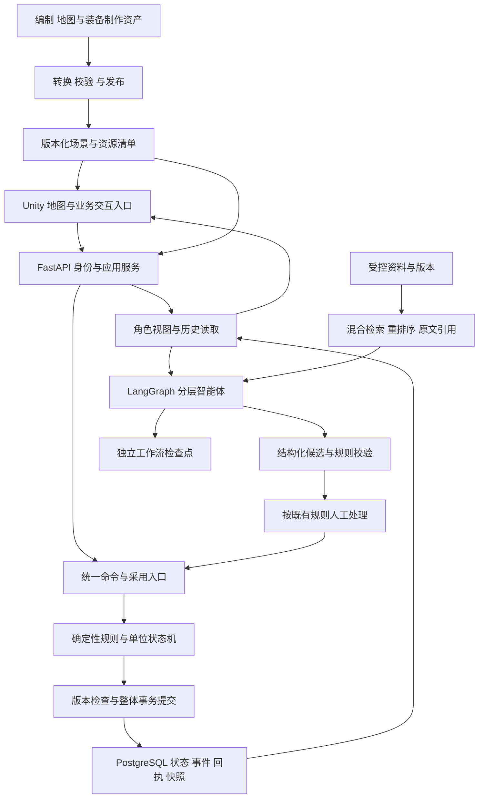
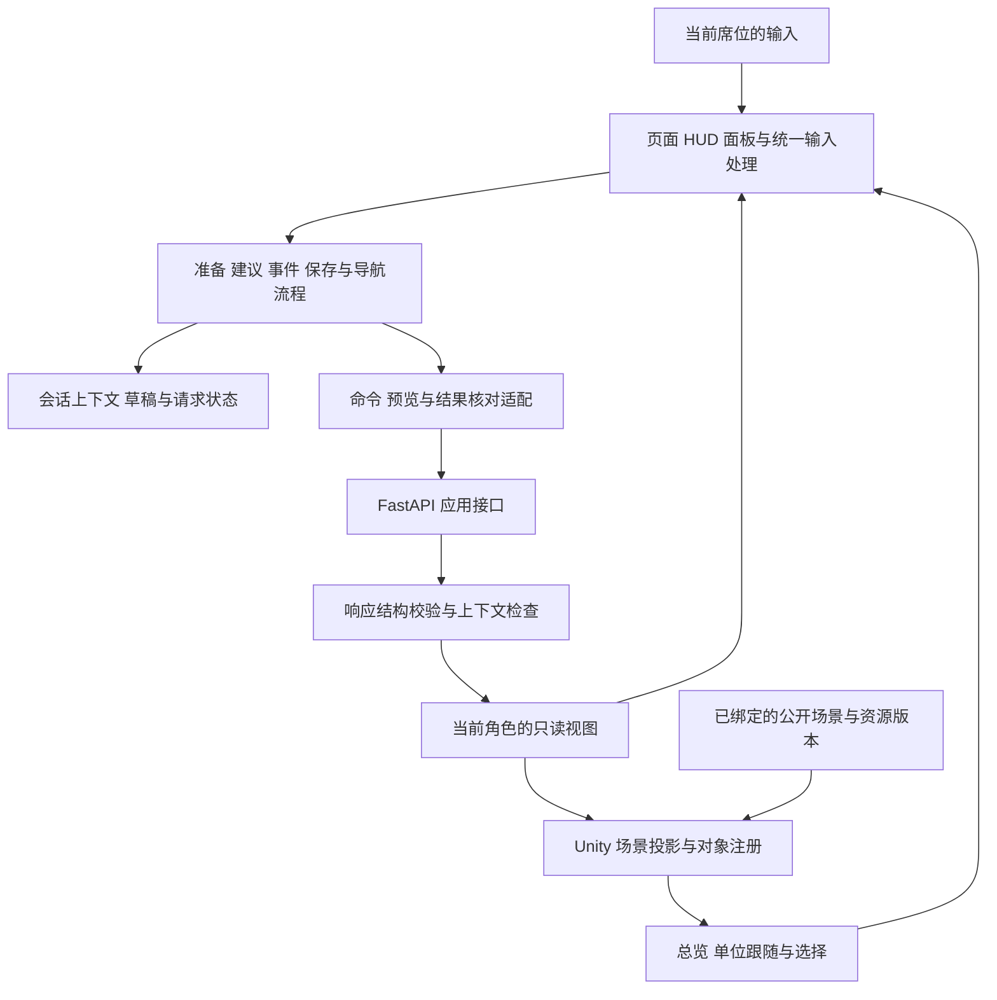
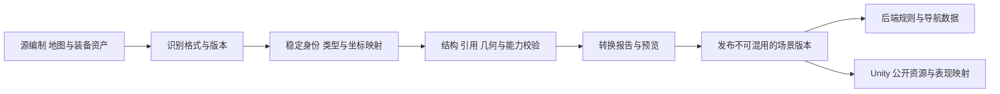

# 系统架构

修订日期：2026-10-31。本文统一描述三项目融合后的目标架构：Unity 负责地图与战斗表现，FastAPI 与确定性规则模块维护权威状态；Army_Editor 提供资产制作能力参考，Gentactix-DSH 提供命令、智能体运行及证据追踪能力参考。架构规划、候选扩展和运行验收分别记录。

同一文件按具名部分组织；部分内部保留原章节号，未带文档名的“第 N 节”指该部分的原编号。需求与验收编号用于追踪，合并不代表待定方案获批或产品验收通过。

<a id="tech"></a>

## 文档导航

- [一、总体架构](#section-01)
- [二、后端架构](#section-02)
- [三、前端架构](#section-03)
- [四、三项目融合与端到端流程](#fusion)
- [五、实施边界与融合验收](#integration-checks)

<a id="section-01"></a>

## 一、总体架构

### 1. 文档范围与设计依据

本文承接 [产品需求](01产品需求.md) 的 PRD-01 至 PRD-36，与 [仿真规则与参数](02仿真规则与参数.md)、[Unity 地图与战斗视角](03Unity地图与战斗视角.md)、[交互与视觉设计及页面线框](04交互与视觉设计.md#wireframes) 配套。API 与字段定义以 [接口契约](06接口契约.md)、[数据库设计](07数据库设计.md) 为详细设计入口；存在差异时登记并对齐，不在本文另造一套报文或数据表。

| 范围 | 架构要求 | 当前状态 |
| --- | --- | --- |
| 原沙盘核心 | 固定虚构场景、三角色、双方各四个逻辑智能体、人工确认、确定性推进、事件、计分和保存恢复 | 沿用既有要求；文档描述不代表完整链路已验收 |
| Unity 表现 | 三维总览、单位跟随、角色过滤后的地图与战斗表现 | 引擎与两种视角已确认；版本、发布形式、UI 与镜头参数待 D-15 |
| 三项目基础融合 | 场景版本、统一命令检查、基础回执、资料证据和数据完整性 | 服务于原首版；具体字段、事务实现与运行结果需逐项验证 |
| 增强功能 | 编制与地图编辑、装备资产库、单位 Agent、高级模型配置、完整审计与导入导出 | 按 PRD-24 至 PRD-36 标注的候选范围逐项设计，不因画出模块而纳入首版 |
| 分析与工程能力 | 只读反事实分析、调试单步和性能取证 | 分析为后续 P2；调试按工程权限隔离 |

本文保留既有技术方向，并补足模块边界与融合约束；本轮只修改架构文档，不创建 Unity 工程、不变更数据库、不安装依赖。后文模块名、上下文标签和流程阶段均为职责设计，不冒充已经存在的类、接口或运行状态枚举。

### 2. 已选技术与后续扩展

| 编号 | 层次 | 首版选择 | 决定理由与边界 |
| --- | --- | --- | --- |
| ARCH-01 | 地图与战斗客户端 | Unity 三维沙盘总览 + 单位跟随视角 | 用户已确认引擎与观察模式；版本、发布形式及业务面板承载方式待确认，现有 Vue 原型供交互参考 |
| ARCH-02 | 后端 | Python + FastAPI，模块化单体 | 在同一后端内划分清晰模块，提供状态、对局和方案接口；先控制部署复杂度 |
| ARCH-03 | AI 编排 | LangGraph | 管理有状态分析、工具调用、校验、人工中断和恢复；不要求同时使用整套 LangChain |
| ARCH-04 | 知识接入 | 混合 RAG + 版本过滤 + 重排序 + 原文引用 | 结合关键词与语义检索，保留章节上下文；具体中文解析、向量及排序模型须评测 |
| ARCH-05 | 数据 | PostgreSQL + pgvector | 对局、事件、存档与知识元数据统一管理，向量检索作为数据库扩展；原始文件单独保存并关联元数据 |
| ARCH-06 | 游戏执行 | 独立确定性规则模块 + 单位状态机 | 规则模块维护权威游戏状态，模型只提交建议；复杂执行行为后续再评估行为树 |
| ARCH-07 | 模型接入 | 可替换的生成、向量与重排序接口 | 分别评估三个角色的模型，不以同一品牌或同一模型覆盖全部职责 |
| ARCH-08 | 存档复盘 | 状态快照 + 事件 + 已采用方案记录 | 重放已发生结果，不依赖模型再次生成相同文本或动作 |
| ARCH-09 | 质量验证 | 固定场景集、检索集与版本化运行记录 | 验证引用、权限、规则、恢复、成本和运行表现，不使用未经实测的性能排名 |

#### 2.1 有条件扩展

| 技术 | 当前定位 | 引入条件 |
| --- | --- | --- |
| 长上下文与上下文缓存 | 模型适配层支持的可选能力 | 核心资料或完整章节需要直接阅读，且模型、成本及有效性验证通过；不替代游戏状态接口 |
| 受控的补充检索 | 混合 RAG 稳定后的增强 | 发现证据不足时允许调整查询，须设置调用预算和停止条件，具体参数待定 |
| Neo4j / GraphRAG | 关系查询扩展 | 文档概念、规则依赖、版本引用等多层关系成为真实需求，且对照评测证明收益 |
| Qdrant 等独立向量服务 | 检索服务扩展 | 实测显示 PostgreSQL 方案在检索负载、部署隔离或功能上存在具体缺口 |
| LlamaIndex 等文档组件 | 按需组件 | 复杂解析或索引需求超出首版模块能力；不为重复功能叠加整套编排框架 |
| Dify 等知识工作台 | 可选管理侧试验 | 有明确可视化知识管理需求；整局权威状态和规则执行仍由游戏后端管理 |
| 微调 / LoRA | 后续评测项目 | 已有审核后的样本、独立验证集和明确需要改善的行为，且对照现有方案获得收益 |
| 模仿学习 / 强化学习 | 长期游戏研究方向 | 仿真环境、动作定义、反馈和评测稳定后另立范围与预算 |
| 学习型世界模型 | 首版不采用 | 需要独立预测目标、数据和验证，不能用模型想象替代当前规则引擎 |

上述选择记录架构方向，不代表已安装任何新依赖。实施时再锁定具体版本、许可证和目标平台运行结果。

### 3. 模块结构与数据流




首版采用模块化单体：应用服务、仿真、视图投影、知识检索、智能体编排、存档复盘和评测在同一后端工程中保持独立职责。图中资产转换代表后续编辑与导入的接入边界，首版可由受控固定资产供给，不要求先交付完整编辑器。模型服务通过适配接口连接，可以在独立位置运行。是否进一步拆分服务，由实际负载和运维需求决定。

后端对单局状态变更采用统一写入入口；界面和智能体都不能绕过规则模块直接修改单位、资源、视野或得分。候选通过格式检查、人工点击采用、命令被受理和动作实际执行是不同事实，客户端不能把其中任一前置阶段显示为已完成结算。具体同步传输协议、数据库表结构和接口字段在详细技术设计中确定。

角色视图中的动态对象必须先在后端过滤，再序列化给 Unity 或网页面板。场景资源清单可以描述公开地形和通用模型，却不能借公开资源元数据预装隐藏单位、私有库存或对方实时坐标。主持人能观察全局不等于可代红蓝确认或行动；其对局中详细建议访问范围仍按 D-08 待确认。

### 4. 权威状态与信息隔离

#### 4.1 状态来源

单位坐标、状态、资源、任务、道路与航线、事件和计分从仿真状态接口获取，不能用向量相似度检索代替精确读取。模型每次分析使用明确的对局、分支、阵营、仿真步和状态版本。

规则模块根据已确认视野生成本方观察快照。红方、蓝方和主持人视图分别处理：主持人全局状态不得注入双方智能体，也不能通过检索、工具、缓存、摘要或方案解释泄露隐藏对象。

#### 4.2 规则、资料与历史

- 已确认游戏规则由程序指定有效版本，相关摘要作为当前分析上下文；原始规格仍可追溯。
- 外部文档作为参考证据，保留来源及版本；模型提取内容经过审核后才可进入正式规则或案例集合。
- 事件和对局历史用于复盘及评测；单次成功不自动成为通用规则。
- 不确定报告、最后发现记录和当前可见状态明确区分，不把历史记录当实时事实。

### 5. 知识接入与混合 RAG

#### 5.1 导入与索引

导入管线按文件格式解析文本、章节、表格和页码。扫描件只有在完成可用文本提取后才进入检索；解析失败要报告失败状态。具体支持格式与解析工具在文档样例验证后确定。

每份资料记录文档标识、名称、来源、版本、内容摘要或校验值、解析状态与审核状态。分块保留章节及父子关系，每个片段能够追溯原文位置，必要时回取完整章节。

向量索引记录向量模型及其版本。更换维度或模型时须重建或分开管理索引，不能混用不同模型空间的向量。中文分词、术语和版本号检索使用真实资料测试，不能假定默认全文配置已满足要求。

#### 5.2 查询流程

1. 按本次游戏任务、待解释问题和允许使用的信息构造查询。
2. 先限制可用资料集合、审核状态、版本与权限，再分别进行关键词及语义检索。
3. 合并候选、去重并重排序，优先保留相关且可追溯的证据；具体融合方式、候选量和阈值通过评测确定。
4. 缺少上下文时读取对应完整章节，仍不足则标明资料不足；补充查询须受预算控制。
5. 输出证据与来源标识，交给 AI 工作流使用；不能把相似度当成观点正确性或方案执行许可。

#### 5.3 上下文组合

一次分析的上下文由当前有效游戏规则、本方可见状态、相关文档证据、必要的历史记录和明确的未知项组成。长上下文或缓存用于复用适当资料，不能自动补全缺失状态。

缓存必须匹配资料、规则及模型版本；涉及对局私有信息的结果还须隔离对局分支、阵营和状态版本。离线时，已有本地索引是否可用取决于模型部署；无法解析或向量化的新资料不得显示为已完成索引。

### 6. 分层智能体与人工确认

双方各保留总指挥、侦察无人机、陆兵、保障四个逻辑智能体，共八个。角色身份和上下文可分离，但不要求八个独立模型，更不为每个地图单位创建独立 LLM 循环。

总指挥组织局势摘要、候选方案、引用依据和未知信息；兵种智能体管理对应类型单位、报告状态与执行进度。单位持续动作由状态机执行，LLM 在需要分析或调整时参与。

工作流顺序为获取有效快照、组织资料证据、提出结构化建议、校验、按规则等待人工处理、提交执行、记录结果。失败时返回明确原因，不无限重试；调用预算、超时及恢复参数待模型与性能评测后确定。

建议结果须能表达方案编号、对局与分支、阵营、依据状态版本、涉及任务与单位、建议内容、引用来源、未知项、校验结果和人工处理记录。具体字段名与结构在接口设计中确定。

格式校验只证明结构可读。权限、对象可用性、动作互斥、路线与资源等执行条件仍由规则模块校验；采用前再次核对状态版本，旧方案不得覆盖新状态。

首次分配与重大调整继续遵守原有人工确认。模型不可用时显示建议服务不可用并保留待处理状态，不生成伪建议或绕过确认。

### 7. 仿真执行与持久化

#### 7.1 确定性执行

仿真规则模块维护统一状态，并按既有每步 1 分钟、最多 60 步推进。同一步动作、视野、任务、资源及得分变化遵守配套规则，不由模型文本或界面动画结算。

执行入口检查方案是否被允许采用、是否过期、是否重复提交。单局变更须保持可追溯的先后与版本，防止多窗口或工作流恢复导致重复动作和重复扣费。事务边界与并发控制在详细设计中落实。

#### 7.2 游戏存档与工作流检查点

| 类型 | 职责 |
| --- | --- |
| 游戏快照 | 保存兵营、单位、编队、位置、资源、任务、路线、探索及事件等整局状态 |
| 游戏事件 | 记录已采用动作、人工处理、变化原因、计分与前后版本，支持复盘 |
| AI 工作流检查点 | 记录某次分析、工具调用与等待处理进行到哪里，支持中断恢复 |
| 知识与模型版本 | 标识资料、索引、提示模板、模型及游戏规则，为结果追溯提供依据 |

游戏存档与 LangGraph 检查点关联但分别管理。恢复工作流时必须重新核对对应游戏分支和状态，不能认为恢复检查点就已经恢复整局，也不能保证它与游戏事务天然同时提交。

读档按既定规则恢复整局并保持暂停；旧分支或旧状态的异步模型结果不得应用到当前分支。具体分支编号、取消机制和检查点绑定在接口及存储设计中确定，不能擅自决定尚未确认的多次尝试胜负展示规则。

复盘重放保存的状态、事件和已采用方案，不重新调用 LLM 来生成过去的结果。现有首版确定性规则不加入新的随机行为；如未来规则引入随机性，须另行记录相应随机状态。

### 8. 部署、离线与目标平台

首版在当前 Windows 电脑运行前端、Python 服务和本地 PostgreSQL。具体安装方式、依赖版本与启动方式在实施阶段按实际环境验证；模型可通过配置服务调用，来源、地点和预算待选型测试。

核心仿真、计分及已保存复盘保持离线可用。远端生成、向量或重排序模型不可用时，其依赖能力明确降级，不影响已有状态与记录的正确读取；需要 AI 确认的首次方案仍按既有流程保持待处理。

鲲鹏阶段优先验证 API、数据库、检索及仿真在目标环境的运行。模型服务可独立部署，不将通用计算平台等同于已具备特定推理能力。ARM64 运行库、数据库扩展、模型服务与性能均需实测。

鸿蒙阶段优先承担地图展示、状态读取和人工交互。具体终端、客户端形态及通信实现另定，不以浏览器原型替代鸿蒙实际验收。

### 9. 评测与验收

| 编号 | 验证内容 | 需要提供的证据 |
| --- | --- | --- |
| ARCH-TEST-01 | 关键词、术语、版本和语义检索 | 带已知相关原文的中文查询集，记录命中、漏检和引用位置 |
| ARCH-TEST-02 | 引用与资料更新 | 能打开对应原文；文档失效或换版后不继续把旧内容作为现行依据 |
| ARCH-TEST-03 | 结构化建议与规则检查 | 格式正确但越权、状态不可用或资源不满足的建议仍被规则模块拒绝 |
| ARCH-TEST-04 | 信息隔离 | 改变主持人可见而本方未知的信息，不直接改变本方模型输入或解释；检索及缓存无跨方泄露 |
| ARCH-TEST-05 | 人工确认与恢复 | 待确认时不能推进；检查点恢复保留处理上下文，重复提交不重复执行 |
| ARCH-TEST-06 | 存档与异步结果 | 读档恢复同一步；旧分支或旧版本的模型结果不能更新当前对局 |
| ARCH-TEST-07 | 确定性复盘 | 不重新请求 LLM，仍能重开已保存过程及对应计分依据 |
| ARCH-TEST-08 | 不可用与离线 | 模型或索引能力不可用时明确报错；已有规则、记录与离线能力符合原规格 |
| ARCH-TEST-09 | 成本与规模 | 固定资料、模型和场景版本，记录耗时、调用量、费用及不同单位规模表现 |
| ARCH-TEST-10 | 扩展收益 | 增加图谱、专用检索或训练前，与首版基线在相同输入上对照评测 |

硬性规则不得因平均效果更好而放宽：越权、隐藏信息泄露、绕过人工确认及重复执行必须按失败处理。检索质量、运行耗时与费用阈值在样例和预算确定后锁定，不预填虚构数值。

### 10. 实施顺序与待定事项

建议按以下依赖顺序实施，具体工作拆分进入后续设计与开发计划：

1. 建立权威状态、单位状态机和现有游戏规则的确定性运行。
2. 建立三角色状态投影、事件、快照与读档，验证人工确认和信息隔离。
3. 建立模型适配与 LangGraph 流程，验证结构化建议、状态版本和过期结果处理。
4. 使用实际文档验证解析、中文混合检索、重排序与引用，再接入建议流程。
5. 在固定场景中比较规则基线与加入文档证据后的效果，记录成本和运行表现。
6. 确定渲染规模、模型版本和性能参数后，再做鲲鹏与鸿蒙最小适配验证。

| 已确定 | 仍待确定 |
| --- | --- |
| Unity 地图与战斗视角、Python + FastAPI、LangGraph、混合 RAG、PostgreSQL + pgvector、独立规则与状态机、快照及事件 | 具体软件版本、数据库表与接口细则、同步传输、认证与角色会话实现；Unity 发布形式及 UI 承载方式 |
| 模型接口可替换，生成、向量与排序分别评估 | 模型型号、服务来源、运行地点、预算、超时和调用限制 |
| 文档证据可追溯，中文检索须验证 | 文件样例、解析工具、分块、分词、检索融合、重排序参数和质量门槛 |
| 游戏存档与工作流检查点分别管理 | 分支与检查点绑定、并发事务、幂等键、格式升级和历史多次尝试展示 |
| 仿真行为按已有确认规则 | 兵种数值、几何算法、规模样例、Unity 渲染管线与坐标映射参数 |
| 鲲鹏和鸿蒙是后续目标平台 | 目标设备、ARM64 兼容性、部署形态及实际验收指标 |

### 11. 技术依据

以下官方资料用于核对组件能力与取舍，不构成该项目的性能实测：

- [FastAPI 功能说明](https://fastapi.tiangolo.com/features/)：Python API 服务与数据校验能力。
- [LangGraph 概览](https://docs.langchain.com/oss/python/langgraph/overview)：有状态工作流、确定性与模型步骤的组合。
- [LangGraph 人工中断](https://docs.langchain.com/oss/python/langgraph/interrupts)、[持久化](https://docs.langchain.com/oss/python/langgraph/persistence)：暂停、检查点与恢复能力，需由应用绑定游戏状态。
- [pgvector](https://github.com/pgvector/pgvector)、[PostgreSQL 全文检索](https://www.postgresql.org/docs/current/textsearch-intro.html)：向量与文本检索的组合基础，中文效果仍须测试。
- [Qdrant 混合检索](https://qdrant.tech/documentation/search-tuning/hybrid-search/)：语义与精确词检索的互补及额外成本。
- [Neo4j GraphRAG 检索器](https://neo4j.com/docs/neo4j-graphrag-python/current/user_guide_rag.html)、[Microsoft GraphRAG 索引方法](https://microsoft.github.io/graphrag/index/methods/)：图关系检索能力与索引维护取舍。
- [长上下文](https://ai.google.dev/gemini-api/docs/long-context)：长资料输入、缓存思路与有效处理范围的限制。

本轮保留既有版本中的官方参考链接，未重新执行在线版本与兼容性核对。实施前须按最终选择版本验证，不能把这些资料或本文规划视为当前电脑、工程或目标平台上的已验证能力。
<a id="back"></a>

<a id="section-02"></a>

## 二、后端架构

### 2. 服务边界

```text
Unity 地图客户端／保留的 Vue 原型／后续待验证终端
        ↓ 同源 /api 转发或经配置的服务地址
FastAPI 接口层
  请求结构、角色上下文、响应模型、错误转换
        ↓
应用服务层
  对局命令、准备、任务、建议处理、事件、保存与查询
        ├─ 确定性领域模块：权威状态、规则、单位状态机、计分
        ├─ 角色视图投影：红方、蓝方、主持人与赛后记录
        └─ 受控后台任务：LangGraph、文档处理、模型适配
        ↓
持久化与外部能力
  PostgreSQL + pgvector、原始资料目录、模型服务
```

前端、模型和知识检索不得直接写入权威单位坐标、资源、视野、任务进度或得分；所有游戏变更通过统一命令入口校验后提交。数据库和原始资料由后端访问，前端不取得数据库连接、模型凭证或磁盘路径。

服务保持模块化单体，不为每个兵种部署独立服务。八个逻辑智能体共享后端能力，但隔离阵营与分析上下文，不等于八个模型实例；地图增加单位也不为每个单位创建独立 LLM 循环。

首版建议 HTTP 命令与角色快照查询，配合前端建议的串行轮询；查询不推进时间。是否增加 SSE 或 WebSocket 由实际交互与负载决定，不在后端同时维护多套状态源。角色会话的具体建立和分发方式留 API 规格，不能信任 URL 或请求体自报的主持人身份。

### 3. 模块职责

| 模块 | 核心职责 | 不承担的职责 |
| --- | --- | --- |
| `api` | 请求入口、依赖装配、身份上下文、响应与错误映射 | 直接写 SQL 或分散实现游戏公式 |
| `schemas` | 请求与响应结构、枚举、有限数值、空值与字段错误 | 决定对象是否被发现或动作是否允许 |
| `sessions` | 服务端角色上下文、对局成员与操作资格 | 从前端角色切换直接授予权限 |
| `games` | 对局生命周期、统一命令入口、分支与状态版本、推进控制 | 在内存中维护脱离持久化的第二份权威状态 |
| `scenarios` | 固定地图、部署区、任务模板、场景参数与规则版本加载 | 从背景图片猜测道路、遮挡或可飞区域 |
| 资产转换职责（候选） | 源格式适配、编制树与引用校验、稳定 ID 映射、资源清单及发布报告 | 直接把源编辑器运行态写入对局或默默补齐缺失装备 |
| 命令与回执职责 | 在 `games` 应用边界统一记录来源、草稿修订、采用资格、执行关联与处理结果 | 另建一条可绕过规则及人工确认的执行通道 |
| `preparation` | 兵营占地及连接点、部队配置、双方准备与开局检查 | 运行中新增兵营、部队或虚构建造价格 |
| `simulation` | 纯规则状态转换、动作占用、路径过程检查与同一步结算 | 调用模型、访问网络或由动画决定结果 |
| `units` | 单位状态机、编队归属、主任务、资源与对象持有关系 | 为每个地图标记创建持续模型调用 |
| `observations` | 三态探索、报告来源与有效时间、失视与通信未知 | 将主持人全局状态直接提供双方 AI |
| `views` | 在一致状态版本上生成角色快照、列表、摘要及时间线 | 只隐藏地图图标却返回私有完整对象 |
| `tasks` | 四类任务、节点条件、目标替换与终结检查 | 用路线预测超时直接宣判失败 |
| `proposals` | 结构化建议、校验、版本、人工修改与采用记录 | 自动绕过确认或执行过期方案 |
| `agents` | LangGraph 流程、四角色协作、分析运行与人工中断恢复 | 直接提交未经命令入口校验的状态变更 |
| `knowledge` | 文档版本、解析状态、检索、重排序及原文引用 | 把参考文档内容自动变成游戏规则 |
| `models` | 生成、向量化、重排序适配，调用预算与失败映射 | 在前端暴露供应商接口或凭证 |
| `events` | 四类注入、脚本与手动触发、持续与恢复记录 | 因注入本身直接扣安全分 |
| `scoring` | 任务、资源、安全及总分的单一计算实现 | 按演示数字或每次读取重新产生扣分 |
| `saves` | 自动／手动快照、恢复校验、暂停读档、退出协调 | 把 LangGraph 检查点等同于完整游戏存档 |
| `history` | 历史摘要、已结束结果与只读复盘 | 用新模型或新规则重写过去结果 |
| 分析职责（后续 P2） | 冻结来源、干预项、独立分析身份、假设与结果证据 | 更新主战局有效分支、扣分或生成正式胜负 |
| 诊断与审计职责 | 基础关联记录、完整性检查；后续扩展受控工具轨迹与性能取证 | 向正式角色开放全局私有载荷或直接改状态 |
| `jobs` | 持久化任务状态、领取、执行、失败与恢复协调 | 仅依赖一次请求后的内存回调保证任务可靠完成 |
| `persistence` | 数据库会话、仓储、事务、迁移、资料存储 | 自行改变产品规则或角色权限 |
| `demo_data` | 显式、带标记、可重复的测试场景初始化 | 正式服务故障时静默伪造运行结果 |

模块名表示职责，不强制每项各建独立包。已有 `backend/` 目录；目标职责按接口、应用、领域与基础设施组织，具体结构随实施计划逐项核对，本文件不将设计分层视为已完成实现。

领域计算接收明确状态与动作，返回新状态候选和可追溯变化，不直接提交数据库事务。应用服务决定一个操作的整体事务，仓储不自行零散提交。共享规则不得复制到多个 API 路由或智能体工具中。

### 4. 业务处理流程

#### 4.1 创建对局与场景绑定

主持人选择已支持的任务模板与预设场景，服务端校验地图、双方部署机会、任务节点、事件脚本与规则参数。双方采用同一任务模板、可比初始条件和相同兵种目录；玩家实际部队组合允许不同。

创建记录关联场景、地图资源与导航数据版本、规则版本和配置。尚未确定的兵种数值、几何参数与结算公式不能由服务临时猜测；参数缺失时指出原因并阻止依赖该参数的正式执行。测试场景可使用明确标注的测试参数，不将其写成已确认产品默认值。

对局生命周期与暂停原因分别管理，至少表达未开始、准备、运行、暂停、等待人工确认、结束。只有显式且有权的业务命令可以改变阶段，读取页面、切换角色或连接恢复不能创建、开局或回滚对局。

#### 4.2 兵营配置与开局

红蓝操作员只提交本方准备内容。兵营检查完整占地、本方部署边界、地形与其他对象占用、道路出入口和空中停靠点；前端预览不能替代服务端最终校验。每方一个兵营、三个初始单位及准备阶段免费新增继续适用。

配置数量需为合法整数，不能因“暂无产品数量上限”接受负数、无穷值或不完整数据。不得擅自增加固定单位上限；遇到实际处理能力不足时，返回明确的系统处理失败，不保存一半配置。输入分批方式和规模样例在接口与性能设计确定。

双方准备完成且场景检查通过后，由主持人请求开始。兵营位置固定，关闭新增配置。首次方案尚未确认时保持待处理，不能执行首个仿真步。已确认计划安排单位从兵营对应出发点进入地图；待命成员保留在兵营记录，不在任意地图位置生成。

#### 4.3 统一命令与仿真推进

所有变更以命令表达，关联对局、有效分支、依据状态版本、操作者上下文和稳定请求标识。人工命令、分层智能体建议及未来单位 Agent 候选共用此入口；后者不能取得更高权限或自动扩充可执行动作集合。提交前检查角色、阶段、对象、重复处理及版本，再交领域模块计算。单步推进只增加一个仿真分钟，最多六十步；首次及重大方案待处理时不能推进。

推进使用同一输入状态计算双方动作和受影响结果，检查路径中途的任务、观察与接触条件，不只比较起终点。动作互斥、已确认方案约束和同一步统一结算继续适用；内部检查不额外增加仿真分钟。具体执行阶段、几何算法与参数由详细规则设计锁定，不在本文另造结算优先级。

首版抽象对抗仅按既定资格处理陆兵之间的确定性结果，兵营不参与伤害结算，无人机与保障对象资格不因实现方便而扩展。单位失效、物资交接、服务占用和计分均记录稳定事件标识，反复读取或重放不重复产生效果。

“继续”允许服务端按后续确定的运行节奏发起受控推进，“暂停”阻止后续步骤；运行节奏与后台调度参数尚待设计。已有推进完成提交与下一步准入之间设置明确边界，暂停不宣称回滚已提交的一步。浏览器轮询或动画不能成为游戏时钟，每局只允许一个有效推进执行者。

#### 4.4 探索、报告与角色投影

权威状态保存红蓝独立的未侦察、已侦察当前不可见、当前可见区域，观察来源、获取步、最后有效位置和共享状态。范围、来源可用性、场景遮挡与通信条件共同决定有效观察，不能从地图素材亮暗直接推导发现。

失去全部有效观察来源当步停止对方实时位置更新；按规则保留带时间的最后发现记录。通信中断使用既定五步未知效果，本地信息与共享报告分别处理。历史记录不能在后台继续填入对方真实移动。

从同一有效版本生成地图、任务、单位、报告、摘要与事件快照。操作员接口只序列化允许字段；主持人全局接口不能被双方 AI、工具或缓存复用。发现对方兵营只显示已发现建筑，不返回待命部队、库存或内部任务。赛后已结束记录按既定规则向三角色开放，进行中不提前开放双方完整历史。

#### 4.5 智能体分析、建议与人工确认

分析运行绑定对局、分支、阵营、当前状态版本、规则与资料版本。总指挥协调侦察无人机、陆兵、保障三个兵种智能体；持续单位动作由状态机执行，模型在需要分析或调整时参与。

流程为获取本方有效快照、读取必要规则与资料、产生结构化建议、检查格式及游戏约束、进入人工处理、再次校验并采用、记录结果。建议包含涉及任务与单位、来源、未知项、预期影响及版本，不以格式正确替代动作合法性。

首次分配、目标变化、单位改派或相对已确认计划新增超过四条资源指令继续要求本方操作员确认；修改仅限本方分工、优先级与资源额度。主持人不能代确认。驳回保留原建议与处理记录，不执行原动作，也不虚构下一份已生成方案。

人工处理等待写入持久化状态，不能让一个 HTTP 请求或数据库锁一直等待用户。采用时重新核对当前分支与状态；过期建议返回原因，不能覆盖新局势。实际允许的非重大调整仍经统一命令入口检查并留痕。命令回执应能关联采用决定与后续执行事实；仅进入计划不表示已经扣费或完成任务。撤销未采用草稿不回滚已提交事实，取消模型运行也不能作为撤销已执行动作的入口。

#### 4.6 文档接入与混合 RAG

资料导入记录原文、版本、来源、校验值、解析与审核状态。解析保留章节、表格与页码，具体格式及工具通过实际样例确定；扫描件没有成功得到可用文本前，不能显示已完成检索。

检索先限制本次可使用的资料、审核状态、版本与权限，再进行关键词和向量召回、合并去重、重排序与必要的章节回取。中文分词、融合方式和阈值需要实测，不假设默认全文检索即可满足中文资料。

每条引用关联文档版本与可定位原文。相关性分数不是观点正确性或执行许可，缺少证据时明确不足。规则状态读取走精确接口，不能用向量相似度查询单位当前位置或资源；外部资料中的指令不能覆盖游戏规则、角色权限或工具边界。

缓存按文档、索引、规则与模型版本区分，涉及私有状态时还需隔离对局、分支、阵营与状态版本。向量模型或维度改变时重建或分开管理索引，不混用不兼容空间。文档更新不会重写历史引用，已用证据需能按原版本追溯。

#### 4.7 条件注入、任务与评分

脚本和手动触发共用四类事件定义：设备故障暂停五步、通信报告未知五步、天气导致进度延迟五步、任务变化替换目标至本局结束。预览只计算影响说明，确认触发时重新检查状态与输入，过期预览不能直接执行。

事件具有唯一标识与生效状态；脚本条件重复检查、服务恢复或重复请求不再次注入同一事件。恢复按仿真步处理，不按墙上时间处理，暂停或程序关闭期间不悄悄消耗持续步数。相同对象事件重叠时的组合规则仍需详细事件规格明确，不擅自累加或抵消。

任务变化保留旧目标与节点历史，新目标从零计分，并进入相应确认流程。任务失败继续采用截止或已确认不可恢复条件，路线估时和模型预测不直接替代终结判定。双方任务均终结可提前结束，否则到第六十步结束。

评分模块单一实现现有任务百分之六十、资源百分之二十、安全百分之二十的加权规则。资源按已定义且执行成功的使用指令扣五分，安全按独立实际损失扣二十分，最低为零；开局配置免费、注入本身不直接扣安全分，平分记平局。实际指令计费定义和具体规则参数仍待锁定，不将本次调研建议替换进正式公式。

#### 4.8 存档、读档、退出与复盘

游戏快照保存兵营及连接点、待命与出发单位、编队、位置与动作、任务与节点、资源库存、运输对象唯一持有、路线进度、双方探索、报告、持续事件、待处理建议及评分事实，并关联规则、场景与数据格式版本。

自动保存沿用每步、人工处理和事件触发后的时机，结束时固化结果。建议把自动恢复快照与相应状态变化纳入同一数据库事务：提交成功才声明该版本已持久化，失败不宣称已执行且可恢复。手动存档引用或保存一个完整已提交版本，多个手动存档的槽位、名称与覆盖方式仍待设计。

退出先通过主持人命令暂停整局，再提供存档退出、不存档退出、取消。手动存档成功后才完成存档退出；失败保留对局。不存档退出保留最近成功自动存档，取消返回暂停状态，不删除历史事实。

读档先完整校验存档，再在受控事务中切换到新的有效分支并保持暂停。仿真步可合法变小，分支上下文必须更新；不能用旧命令、旧模型运行或旧工作流结果继续写入。保存的已执行事实不因恢复被重新执行，待处理建议保留可追溯内容并重新绑定恢复后的上下文，不能误判为已确认。

复盘读取保存的状态、事件、建议与计分，不重新调用模型或按最新规则重算过去。读档用于继续游戏，复盘用于只读查看，两个入口不混用。格式或规则不兼容时明确拒绝或进入另行设计的迁移流程，不静默填补缺失状态。

### 5. 数据访问与迁移建议

#### 5.1 持久化结构与访问

数据库继续采用 PostgreSQL + pgvector。建议使用 SQLAlchemy 声明式模型与仓储，通过 Alembic 维护结构迁移；ORM、迁移工具、驱动及检查点适配包是拟实施依赖，本次不安装，实施前再确认兼容版本与锁定方式。

建议首版数据库访问使用短生命周期的同步 `Session`，接口和任务执行边界按实际阻塞方式装配，不能在异步事件循环中直接运行阻塞数据库或 CPU 密集计算。请求与后台任务分别创建自己的会话，不跨线程或并发任务共享会话；模型网络等待不占用游戏事务和数据库行锁。

核心数据分为当前权威状态、命令处理、事件事实、游戏快照、建议及人工处理、后台运行、工作流检查点、知识元数据与原始资料关联。当前状态可结合结构化关系与快照文档保存，具体 JSON、关系表与索引拆分由数据库规格决定，不预设每个图标每步都写一套重复表。

本方案使用快照和事件支持恢复与解释，不承诺仅凭任意日志即可重建所有状态，也不要求首版建设完整事件溯源平台。快照和记录的完整性、格式版本及恢复检查必须明确。

#### 5.2 事务、版本与幂等

| 操作 | 建议事务边界 | 必须保持的结果 |
| --- | --- | --- |
| 准备配置、任务或事件变更 | 校验当前对局后，统一写入状态、事件、版本、命令结果及对应自动快照 | 失败不留下半份配置、半次触发或伪成功记录 |
| 单步推进 | 基于一个有效输入版本计算并整体提交双方变化 | 不因并发或红蓝处理顺序得到额外一步或重复损失 |
| 人工确认 | 核对角色、建议、分支与版本，提交处理记录及采用状态 | 重复处理返回已有结果，冲突不覆盖 |
| 手动存档 | 固定来源版本与完整内容，写入可读取的保存记录 | 成功记录确实可恢复，不引用未提交内存状态 |
| 读档 | 校验完整内容后切换有效分支与恢复状态 | 失败保留原对局，成功后暂停并阻止旧分支写入 |
| 模型或解析结果入库 | 完成外部调用后开启独立短事务核对任务资格与上下文 | 过期结果只留诊断或历史，不采用到当前游戏 |

单局状态变更通过数据库可验证的并发边界串行提交，建议对对局控制记录加行锁并检查依据版本；不能只依赖进程内互斥锁。计算较重时可先基于固定快照计算候选，提交前再锁定并比较版本，失败则拒绝旧候选，不能覆盖新状态。具体选择与性能在实施中验证。

命令幂等记录关联对局、分支、请求标识、操作者和请求摘要。同一标识与相同输入重复到达返回已有结果，输入不同则冲突；命令结果与游戏变更同事务保存。运行中、完成、失败与结果待核对状态分别管理，服务端提交成功但响应丢失时仍能查询已提交结果。

数据库提交异常也可能存在客户端无法判断结果的情况，应通过命令记录重新核对，不向上层承诺所有超时都已回滚。新分支不能重放旧分支未完成命令，已执行事件不能因恢复再次扣分或复制物资。

#### 5.3 迁移与数据生命周期

数据库变更使用版本化迁移，不以每次启动自动建表代替。pgvector 扩展安装或升级是显式部署步骤，不假设应用运行账号拥有扩展管理权限。历史快照、规则、文档和向量模型版本可追溯，迁移不能无声重写已结束结果。

数据清理、存档保留时间和原始资料清理策略尚未确认，首版不自动清除用户存档或引用原文。备份范围应同时覆盖 PostgreSQL、资料目录及引用版本；仅复制一份模型检查点不视为完整系统备份。

### 6. 请求、角色与错误边界

请求采用类型化模型验证对象标识、枚举、整数、有限坐标、必要字段与明确空值。输入结构正确后仍检查权限、阶段、对象可用性、动作占用、路线、资源及方案条件。稳定对象标识与字段路径用于前端定位，不以列表序号或中文名称作为唯一关联。

角色由服务端会话上下文决定，并在命令、状态、建议、引用与历史读取中统一检查。首版仍是同机三角色场景，不扩大为多租户平台或新登录产品；但不能因此取消已确认的角色隔离。会话建立、有效期及恢复方式由 API 规格明确。

| 错误类别 | 对外行为 |
| --- | --- |
| 输入或任务格式错误 | 返回对象、字段与中文原因，保留可修改内容 |
| 阶段或权限不允许 | 拒绝执行，不通过返回体、对象数量或详情泄露无权获知的信息 |
| 旧版本、旧分支或已处理建议 | 返回冲突与需要重新读取的提示，不静默覆盖 |
| 规则条件不满足 | 返回相关可公开原因，不自动放宽条件 |
| 模型不可用、解析失败或证据不足 | 分别报告，不生成伪建议、伪索引或伪引用 |
| 持久化或存档失败 | 明确未确认保存成功，保持有效对局或指导核对结果 |
| 任务处理中或结果不确定 | 返回可查询的处理状态，不能伪装为已成功执行 |
| 历史缺失或版本不兼容 | 明确不可读取，不推测拼接完整过程 |

错误响应包含操作类别、可读原因、必要的对象与字段路径、追踪标识及重试或重新读取语义，具体状态码由 API 规格固定。外部响应和普通页面不暴露连接串、服务器路径、密钥或完整堆栈。日志按权限保存诊断，不能把红蓝私有模型上下文放进公共事件流。

前端超时、取消或关闭窗口不等于服务端命令取消。只读操作可有限重试，变更操作按幂等记录核对；模型恢复可能产生额外供应商调用费用，不承诺外部调用严格只发生一次。预算、超时和重试次数在选型评测后确定。

### 7. 原始资料、向量与快照存储

#### 7.1 原始资料

原始文件建议保存在后端受控的本机持久化目录，数据库保存文件标识、原始名称、版本、大小、内容校验值、解析状态及引用位置。存储键由服务端生成，原始名称只作展示，不直接拼接为磁盘路径。

写入流程区分临时文件、可用原文、解析中、解析失败、索引中和可检索版本。文件与数据库不能假定天然同事务，必须通过状态和补偿处理写入失败或元数据失败；损坏或缺失原文不能保持“可正常引用”状态。

首版支持的文件格式、文件大小、解析器与 OCR 方式通过样例确定。当前没有要求新增资料管理页面，后端导入入口与审核操作可在后续 API 或管理流程设计明确；具体格式和依赖依据本项目资料样例确定。

#### 7.2 向量索引与模型接口

pgvector 与知识元数据继续置于 PostgreSQL，向量记录关联原文版本、片段位置及向量模型版本。生成、向量化和重排序使用独立适配接口，允许分别选择模型。特定向量维度、索引参数、中文词法检索与重排序阈值均为待评测参数。

更换模型时不能把新向量与旧空间混查，停用资料不进入新查询，但已发生对局的引用仍需追溯原版本。远端模型不可用时不把未成功向量化的内容列为已索引；本地已保存游戏与复盘不依赖重新构建索引。

#### 7.3 游戏存档与检查点

首版建议游戏状态、事件和快照优先在数据库中持久化，原始资料另存文件，不新增存档导出产品功能。快照包含格式、规则和场景版本，可校验完整性；具体压缩、分段与大型快照存储方式由规模测试决定。

LangGraph 检查点使用持久化适配，关联分析运行、对局分支、阵营和依据版本，与游戏快照分别管理。恢复检查点不自动恢复游戏或重复执行已完成动作。检查点与应用事务没有天然原子性，需要以应用运行记录、处理结果及恢复核对协调。

### 8. 演示数据与后台任务边界

#### 8.1 演示数据

建议提供显式初始化入口，创建带标记的虚构地图、测试参数、三兵种样例、四类任务与事件案例。重复初始化不重复制造同一批样例，不覆盖用户真实对局和存档；正常启动不自动写入演示对局。

固定 AI 文案仅可在明确演示模式使用，正式模型服务不可用不回退为伪造建议。测试参数、场景版本与模型输出分别记录，某次演示成功不自动升级为正式数值或通用规则。

#### 8.2 长任务执行方案

模型生成、文档解析、向量化和索引可能超过普通请求时间，不能照搬报价模板中“全部由请求同步完成”的边界。建议接口先写入持久化任务记录，再由受控执行器处理，前端轮询运行状态与建议结果。

首版本机建议采用一个应用进程和一个有界后台执行器，任务记录保存在 PostgreSQL，不预先引入 Redis、Celery 或独立消息中间件。具体并发数、任务领取方式、租约与超时待实施设计，不使用未经限制的内存任务堆积替代持久化记录。

执行器领取任务后记录执行代次与归属，结果提交时核对仍有资格；超时回收后旧执行者不能继续覆盖新执行结果。启动恢复区分待运行、执行中、中断等待人工、失败和完成：可核对的任务再继续，不把所有执行中任务一律重跑。

依赖状态的模型任务失效后不能继续采用旧结果；读档或任务变化使旧运行脱离有效上下文。LangGraph 人工中断节点前后的副作用需设计为可核对、可幂等，不能认为从检查点恢复就不会重新经过相关代码。

执行器生命周期跟随应用启动和关闭管理，退出时停止领取新任务并记录运行状态。FastAPI 的请求后后台回调可以承担不要求恢复的轻量工作，但不能单独保证关键分析、存档或索引完成。未来多进程扩展需先验证任务抢占、推进所有权和重复执行，不直接增加 API worker 数量。

#### 8.3 同步、异步与 CPU 工作

普通校验和短数据库操作按同步服务组织；模型 I/O 可使用异步适配或受控工作线程，不能把同步阻塞库直接放入异步路由调用。CPU 密集的仿真与解析需要按样例测量，避免阻塞 API 响应；是否独立进程执行由负载决定，不在本阶段新增分布式调度。

异步任务不共享请求结束后的数据库会话。任何长等待期间不持有对局行锁，防止一份模型建议阻塞主持人暂停、保存、状态查询或其他合法操作。

### 9. 运行配置与持久化

#### 9.1 本机与生命周期

当前 Windows 电脑先运行前端、FastAPI、PostgreSQL 和受控资料目录；具体安装、启动脚本、服务端口、锁定依赖与模型来源在实施阶段确定。本规格不把 Docker 设为强制新增门槛，也不安装数据库、驱动或框架。

配置至少区分数据库连接、资料目录、模型与索引、演示模式、任务执行、超时和日志。密钥仅由后端读取，不进入 Unity 或 Vue 客户端产物、URL、普通错误响应或演示样例。路径按配置解析并检查，不能依赖开发电脑上的某个临时目录永久存在。

建议使用 FastAPI 的 lifespan 管理连接资源和后台执行器，启动时检查必要配置、数据库与迁移版本、资料目录及 pgvector 能力。迁移与演示初始化单独执行，不以服务启动自动修改数据代替部署步骤。

#### 9.2 健康、恢复与诊断

健康状态区分进程存活、核心依赖就绪与模型／索引能力。外部模型故障明确降级，不把已保存复盘判为不可读；数据库不可用时不能宣称权威变更或存档成功。健康检查通过不等于规则、模型效果或平台验收通过。

重启后从已提交记录恢复当前对局与后台任务。建议服务恢复时将原运行对局置于技术恢复暂停并告知主持人，避免用户不知情时补推进；这是本阶段建议，仍待确认。已有游戏步和持续事件不会按停机现实时间自动补算。

运行日志关联对局、分支、状态版本、命令及分析运行，记录处理耗时、模型调用量、失败和持久化结果。游戏事实日志与调试日志分开，调试不能成为唯一恢复来源。性能记录使用明确场景与单位数量，不将数量无上限解释为无限吞吐保证。

#### 9.3 离线与平台适配

核心规则、计分及已有复盘在无外部互联网时仍可通过本机后端运行；依赖远端模型的首次或重大方案按既定规则保持待处理，不绕过确认。终端与应用服务器断连时显示断连，不在终端复制一套可自行推进的权威引擎。

后续鲲鹏验证 Python 运行库、数据库、pgvector、模型适配与文件处理的 ARM64 兼容性。具体数据库驱动、解析和向量依赖均按目标系统构建与测试，不把 Windows 环境目录直接复制为部署产物。

OpenHarmony 开发板或自制终端通过受控应用接口访问，不直连数据库或模型服务。板卡型号、系统镜像、Web 承载、网络和会话仍待实机设计，桌面原型不代替平台验收。未来改用容器时，再锁定镜像架构、服务访问范围、数据库与资料持久化配置。

### 10. 验证重点

以下为后续实施验收要求，不代表本文件编写后已经通过。与 PRD、`RULE-01` 至 `RULE-21`、`ARCH-TEST-01` 至 `ARCH-TEST-10` 及前端验收案例共同使用。

| 编号 | 场景 | 应取得的结果或证据 |
| --- | --- | --- |
| BE-ARCH-01 | 场景参数缺失、兵营越界或连接点非法 | 开局或提交被阻止，原因可定位，不生成半份准备状态 |
| BE-ARCH-02 | 已开始对局请求新增兵营或部队 | 按阶段拒绝，免费与无上限不绕过准备期限制 |
| BE-ARCH-03 | 红蓝、主持人读取与操作 | 信息边界一致，主持人不代确认，URL 自报角色不能授权 |
| BE-ARCH-04 | 同一步交换双方动作处理顺序 | 确定性结果一致，不多一步、不漏路径中途条件 |
| BE-ARCH-05 | 并发推进、重复确认或事件重试 | 命令结果可核对，状态仅提交一次，不重复扣费和损失 |
| BE-ARCH-06 | 状态已变、输入变化或旧分支方案返回 | 旧预览与旧模型结果不能覆盖当前对局 |
| BE-ARCH-07 | 失去视野或通信报告未知 | 地图、列表、AI 输入与工具均不收到伪实时对方状态 |
| BE-ARCH-08 | 多个对象服务、交接后存读档 | 动作占用与持有关系正确，库存不重复恢复，物资不复制 |
| BE-ARCH-09 | 持久化失败、响应丢失、超时后重试 | 不伪成功，已提交结果可查询，未提交操作不留半份事实 |
| BE-ARCH-10 | 读档与正在运行的模型／工作流 | 双方同一步暂停恢复，已执行事实不重放，旧任务失去采用资格 |
| BE-ARCH-11 | 服务重启、任务租约过期或重复领取 | 可恢复状态明确，过期执行者不能提交，外部调用重复情况可追溯 |
| BE-ARCH-12 | 模型不可用、文档解析失败或无相关证据 | 分别报告，不生成伪建议、伪引用、伪索引或自动放宽规则 |
| BE-ARCH-13 | 文档换版、索引模型变化和私有缓存 | 新查询采用有效版本，历史引用可追溯，不混用向量空间或泄露阵营 |
| BE-ARCH-14 | 事件脚本重复检查与暂停恢复 | 同一事件不重复注入，持续时长按仿真步，扣分按实际独立损失 |
| BE-ARCH-15 | 已结束结果和复盘重开 | 不重新调用模型或按新规则重算，三项评分、总分与事件一致 |
| BE-ARCH-16 | 无外部互联网、本机服务可用 | 核心规则和已有复盘可用，模型能力按配置降级 |
| BE-ARCH-17 | 显式初始化执行两次 | 不覆盖用户数据，不重复制造同批演示记录，标记持续可见 |
| BE-ARCH-18 | 固定样例在本机与鲲鹏运行 | 记录版本、设备、规模、耗时和恢复结果，区分结构、功能与平台证据 |

重点测试真实事务、并发、权限、恢复及规则结果，不能只用内存模拟证明数据库原子性。文档、类型检查、进程健康、API 功能、浏览器页面与平台实机结果分别记录。尚未锁定的结算参数使用明确测试配置，不声称完成产品数值验收。

### 11. 技术依据

以下资料用于核对技术能力，不能代替本项目兼容性或性能测试。具体依赖版本在开始实施时选定并锁定，本次没有安装依赖。

- [FastAPI 并发与异步说明](https://fastapi.tiangolo.com/async/)：同步与异步调用应匹配所用库的阻塞方式，本项目长任务和 CPU 工作需单独安排执行边界。
- [FastAPI lifespan](https://fastapi.tiangolo.com/advanced/events/)：应用启动、关闭及共享资源生命周期管理；本方案据此设计执行器与连接资源的生命周期。
- [SQLAlchemy 会话基础](https://docs.sqlalchemy.org/en/21/orm/session_basics.html)、[Alembic 教程](https://alembic.sqlalchemy.org/en/latest/tutorial.html)：会话事务与版本化迁移；业务提交、并发与恢复仍由应用设计。
- [PostgreSQL 显式锁](https://www.postgresql.org/docs/current/explicit-locking.html)：数据库行锁与并发控制能力，不保证应用仅靠进程锁即可正确扩展。
- [LangGraph 持久化](https://docs.langchain.com/oss/python/langgraph/persistence)、[人工中断](https://docs.langchain.com/oss/python/langgraph/interrupts)：工作流检查点、等待和恢复；与游戏分支、命令幂等及事务的关联需要自行落实。
- [pgvector 官方仓库](https://github.com/pgvector/pgvector)：PostgreSQL 向量检索扩展；本项目的中文检索、过滤、索引与目标平台表现仍需验证。

本文没有把官方能力说明写成已部署事实，也不以主流框架名称替代具体失败与恢复设计。

### 12. 本阶段后端架构选择与待定事项

#### 12.1 沿用的已确认选择

1. Python + FastAPI 模块化单体，独立确定性规则模块与单位状态机维护权威状态。
2. LangGraph 组织分层智能体流程，八个逻辑角色不等于八个独立模型，模型不直接改写游戏结果。
3. 混合 RAG、版本过滤、重排序与原文引用；精确状态通过规则服务读取。
4. PostgreSQL + pgvector，游戏快照、事件、已采用方案和工作流检查点分别管理并关联。
5. 既定三角色、准备与兵营、任务、事件、评分、确认、存读档及复盘行为不变。
6. 首版本机开发，后续验证鲲鹏与 OpenHarmony 开发板或自制终端，模型部署独立评估。

#### 12.2 本文建议，待本阶段确认

1. 使用统一命令入口、数据库可验证的单局并发边界、版本检查与命令幂等记录。
2. 使用 SQLAlchemy 和 Alembic，首版短同步数据库会话与长任务隔离，不在模型等待期间持有事务。
3. 自动恢复快照与对应状态变更同事务持久化，手动存档固定完整已提交版本。
4. 采用 PostgreSQL 持久化任务记录与单应用进程的有界执行器，不预先引入独立消息中间件。
5. 原始资料存受控持久化目录，元数据、引用与向量在数据库管理，文件写入失败通过状态与补偿处理。
6. 服务重启后建议进入技术恢复暂停并提示主持人；具体恢复交互在确认后同步规格。
7. 先使用 HTTP 命令和角色快照支持前端轮询，生命周期通过 lifespan 管理，不新增强制容器化要求。

#### 12.3 后续规格需锁定的事项

| 项目 | 待确定内容 |
| --- | --- |
| 数据库 | 表结构、字段、索引、约束、快照格式、命令和任务记录、迁移及备份方式 |
| API | 端点与报文、角色会话、状态版本、幂等标识、操作查询、错误码和字段路径 |
| 仿真参数 | 数值、计费、几何算法、事件重叠、执行阶段及规模样例 |
| 工作流 | 模型与提示版本、调用预算、超时、任务领取、恢复代次、检查点与分支关联 |
| 资料 | 文件样例、解析与 OCR、中文检索、分块、融合、重排序、审核与访问入口 |
| 存档 | 槽位、命名、覆盖、清理、兼容迁移及旧分支历史展示 |
| 运行 | 依赖与驱动、服务与执行器启动、推进节奏、静态代理、日志、持久化目录和平台指标 |

本轮交付为架构文档修订，不创建后端代码或数据库。已有接口与数据库文档继续作为详细规格入口；融合新增字段、错误语义及数据关系应在对应实现前对齐，并按 [实施计划与交付范围](10实施计划与交付范围.md) 逐项推进。
<a id="front"></a>

<a id="section-03"></a>

## 三、前端架构

本部分定义前端的工程职责、页面装配、交互状态、数据适配、Unity 表现和交付方式。这里的“前端”包含用户直接操作的地图、HUD、业务面板、目录及复盘界面；是否由 Unity 单独承载，或与网页组合，仍按 D-15 决定。下列分层是目标设计，已有 Vue 文件只作为明确可核对的实施参考。

本部分入口：[定位与发布形态](#frontend-scope) · [分层与依赖](#frontend-layers) · [页面与导航](#frontend-navigation) · [模块与工程组织](#frontend-modules) · [组件与输入](#frontend-components) · [资源与发布](#frontend-release) · [迁移与检查](#frontend-review)。第五至第九节保留状态、通信、地图及存档细则，和前面的结构设计共同组成前端架构。

<a id="frontend-scope"></a>

### 1. 前端定位、技术状态与发布形态

| 内容 | 现行定位 | 确认与实现边界 |
| --- | --- | --- |
| Unity + C# | 正式三维地图、单位与战斗表现、总览和跟随、场景点选及选中标记 | Unity 引擎与双视角已确认；尚无已创建的本项目 Unity 工程，版本、管线、UI、输入和构建目标待定 |
| Vue 3 + TypeScript + Vite | 现有 `sandbox-prototype/` 的页面、表单、请求与演示实现 | 当前 `package.json` 与源码可核对；可复用交互及接口经验，不自动成为正式产品必须保留的外壳 |
| FastAPI 应用接口 | 前端读取角色视图、提交意图、查询命令及历史的唯一业务通道 | 前端不连接数据库或直接调用模型供应商，不读取原始全局快照作为红蓝输入 |
| UI 与本地状态 | 将快照组织为可读界面、管理草稿/焦点/选择/相机/请求状态 | 组件框架和状态库不在本文新增；前端不复制仿真、发现、伤害或计分公式 |
| 资源和类型契约 | 固定场景清单、对象映射、C#/TypeScript DTO 与版本校验 | 实际生成和校验方式待 B0 确定；不能从静态类型推断外部 JSON 必然有效 |

D-15 下需评审的承载形式如下。它们是候选关系，不要求同时维护三套正式客户端，也不默认改变既有本机三席位权限。

| 候选形态 | UI 与地图组织 | 必须验证的边界 |
| --- | --- | --- |
| Unity Windows 客户端 | Unity 内部承载地图与选定的运行时 UI，C# 适配器访问后端 | 本机服务连接、席位会话交付、中文文本、输入与窗口生命周期、实际构建与资源加载 |
| Unity Web 与网页业务 UI 组合 | Unity 负责三维区域，网页承载选定 HUD/业务面板；一个会话适配职责协调数据与桥接 | 浏览器加载与权限、跨源配置、输入焦点、资源版本、桥接数据一致性；网页构建不能替代 Unity 构建 |
| Unity Web 内部承载业务 UI | Unity 内部管理地图及业务 UI，网页仅提供选定承载入口 | 目标浏览器支持、构建加载、接口授权和交互表现；不因存在网页入口就要求 Vue 业务面板 |

Unity UI 采用 UI Toolkit、uGUI 或其他既有可行方式的具体决定，需结合最终 Unity 版本、发布形态、中文显示和本项目面板需求审阅。本文只规定职责和状态流，不将某个 UI 框架、相机包、网络库或新增路由/状态库列为已批准依赖。

<a id="frontend-layers"></a>

### 2. 分层结构与依赖方向

前端按“界面 → 业务流程协调 → 会话与只读视图 → 接口/平台适配”组织，Unity 地图是受控表现入口。分层约束可在同一个工程实现，不要求拆成多个应用或为每层新增框架。



| 分层 | 输入与输出 | 依赖规则 |
| --- | --- | --- |
| 应用装配与导航 | 运行配置、席位会话、页面上下文 → 页面与服务生命周期 | 负责装配与释放；场景/业务组件不自行创建全局会话或替换发布配置 |
| 页面与组件 | 只读展示模型、草稿和操作资格 → 选择、编辑、预览、确认等意图 | 不直接访问数据库、模型或各自发起一套全局轮询 |
| 业务流程协调 | 用户意图、当前依据与草稿修订 → 请求、回执核对及 UI 反馈 | 负责执行交互流程，合法性由后端决定；不把按钮点击等同业务成功 |
| 会话与视图适配 | `GameView`、收据、运行及历史响应 → 版本一致的展示模型 | 统一检查身份/分支/请求序号；原响应先校验，再替换有效视图 |
| Unity 场景表现 | 允许对象、公开资源、有效路线及事件 → 模型、标记、动画与相机目标 | 按稳定 ID 更新显示，不从 Transform、碰撞或动画反向结算业务 |
| 基础设施与平台适配 | HTTP、凭据引用、配置和必要桥接 → 明确的传输与平台结果 | 不含游戏规则；屏蔽网页与原生实现差异，便于替换发布形态 |

视图映射可以计算标签、中文枚举、分项展示和按钮布局，却不能重新推导隐藏对象、资源变化或任务结果。地图、HUD 与业务面板共享同一次有效角色视图；只读复盘使用独立上下文，不覆盖实时对局状态。

<a id="frontend-navigation"></a>

### 3. 页面组织、导航与场景生命周期

导航由统一职责维护页面、来源入口、对局及允许的历史定位参数。网页可映射到地址，Unity 原生可使用应用内导航状态；页面编号表示产品状态，不要求创建十个 Unity Scene 或十条独立路由。已有默认直达沙盘的交互继续按 P-01 的空状态处理，不额外增加强制启动首页。

| 页面 | 前端装配职责 | 生命周期和返回边界 |
| --- | --- | --- |
| [P-01 未开始](04交互与视觉设计.md#p-01) | 空沙盘、实际角色、创建输入、历史入口与服务反馈 | 无对局显示明确空状态；创建成功才绑定真实对局，不在刷新或组件挂载时无条件重建 |
| [P-02 准备](04交互与视觉设计.md#p-02) | 部署地图、本方配置草稿、任务输入、预览与准备状态 | 预览依据与输入修订关联；离开前按既定草稿政策处理，不将本地预览写成已部署事实 |
| [P-03 操作员](04交互与视觉设计.md#p-03) | 本方 HUD、单位/任务、双相机、建议与回执入口 | 选择当前可见对象，私有数据随席位与分支清理；不显示主持人控制入口 |
| [P-04 主持人](04交互与视觉设计.md#p-04) | 全局观察、运行控制、等待摘要、事件与保存入口 | 全局观察与代操作分开；详细建议访问仍按 D-08 待确认 |
| [P-05 建议](04交互与视觉设计.md#p-05) | 沙盘内抽屉：原建议、证据、修改草稿、预览及处理结果 | 属于实时页子状态；关闭不结束人工等待，不销毁当前有效地图上下文 |
| [P-06 事件](04交互与视觉设计.md#p-06) | 主持人事件抽屉：输入、影响预览与提交反馈 | 输入或依据改变使预览失效；不借打开面板自动触发事件 |
| [P-07 存档与退出](04交互与视觉设计.md#p-07) | 保存/恢复确认与退出选择，明确最近有效记录 | 保存成功或失败据真实结果显示；取消退出返回已暂停局，不自动继续 |
| [P-08 历史](04交互与视觉设计.md#p-08) | 有权目录、筛选、加载、空列表、恢复与复盘入口 | 记录来源入口和筛选；失败不丢失当前有效对局，不把目录资格当本局命令资格 |
| [P-09 结果](04交互与视觉设计.md#p-09) | 已冻结分项、总分、正式结果、事实和复盘入口 | 未结束不伪造结果；来自分析的假设胜负不能装配成正式结果 |
| [P-10 复盘](04交互与视觉设计.md#p-10) | 冻结帧、时间轴、双相机及当时证据 | 显示实际已加载帧；返回原结果或历史入口，不向实时局提交动作 |

前端区分页面导航、业务阶段和面板状态：P-03/P-04 可以显示暂停或等待人工，打开 P-05 并不新建对局阶段。页面和面板只按服务端资格提供操作；地址、组件可见性或本地角色值不能授予权限。

建议将应用服务生命周期、对局显示生命周期和面板生命周期分开：关闭抽屉只释放其输入/预览订阅；退出对局或切席位才停止该上下文同步并清理私有对象；从实时页进入复盘不复用可写草稿或继续执行旧命令。Unity 是否跨页面保留同一场景实例按资源实测确定，业务语义不依赖这一实现选择。

<a id="frontend-modules"></a>

### 4. 前端模块与工程组织

| 职责名称（规划） | 管理内容 | 对外边界 |
| --- | --- | --- |
| 应用入口与装配 | 公开运行配置、席位会话适配、导航、各服务生命周期 | 注入明确的本次会话；组件不以模块级单例复用上一席位的私有数据 |
| 会话控制 | 当前资格、对局/分支/快照、上下文失效与刷新 | 令牌仅交给选定的受控传输层，UI 只读角色与资格摘要 |
| 角色视图适配 | DTO 校验、枚举/空值、只读展示模型和版本切换 | 统一快照提交点，HUD、地图和详情不能各自使用不同分支 |
| 页面流程 | 创建、准备、建议处理、事件、存档、历史和结果 | 分别管理草稿、预览、处理中、失败和待核对，不共享模糊的全局 loading |
| 命令协调 | 稳定请求身份、原输入、原上下文、收据与结果查询 | 未确定结果先核对；重试不无条件换键，也不提前改变游戏事实 |
| Unity 场景投影 | 公开场景加载、业务 ID 到显示对象的注册、区域/路线/探索显示 | 对象来自允许数据；缺资源明确报告，不用另一兵种模型反推能力 |
| 相机与选择 | 总览、单位跟随、射线点选、返回入口、失视降级 | 选择输出稳定 ID 或业务坐标；相机只改观察状态，目标引用随上下文失效 |
| HUD 与面板 | 任务、单位、建议、事件、时间线、回执和连接反馈 | 订阅一致展示模型，发出业务意图；不自行轮询或执行结算 |
| 资源与平台 | 资源版本、中文显示资源、HTTP、必要网页桥接、发布配置 | 具体技术由 D-15 与依赖规则确定；凭据和私有资料不进入公开资源 |
| 复盘适配 | 独立只读上下文、最新帧请求、时间轴与返回位置 | 可以复用地图显示组件，不能复用实时写入口或重算过去模型输出 |

如果创建 `unity-client/`，工程可按 `Assets/Scripts` 下的应用、会话、契约、接口适配、功能流程和场景表现职责组织，UI 与公开资源分别归档。这里仅给出职责划分，不创建目录，不固定程序集数量、组件类名或要求引入额外架构框架。实际目录应随首个最小调用链确定，避免没有调用方的空包。

网页部分若获选保留，可按现有 `pages/`、`components/`、`shared/` 的方式逐步整理请求与业务职责；不因本文设计而全量重写原型，也不强制引入 Vue Router、Pinia 或另一套组件库。跨端 DTO 的名称、结构和校验入口由契约统一，C# 与 TypeScript 的实现不能分别发明动作或权限含义。

### 5. 状态归属

| 状态 | 建议归属 | 更新与失效边界 |
| --- | --- | --- |
| 当前页面与导航上下文 | 客户端导航适配模块 | 页面切换时同步；网页地址参数只作为候选承载形式的导航输入 |
| 当前角色与可用操作 | 应用会话上下文 | 由服务端校验结果决定；角色变化清除旧方私有数据 |
| 对局、分支、状态版本与快照 | 会话与状态适配职责 | 同一时刻使用一个有效上下文，不合并不同分支快照；Unity 与业务面板共享版本依据 |
| 准备配置、任务输入及错误 | 对应业务流程，由页面协调 | 保留用户原始输入；输入或关联状态变化后旧校验失效 |
| 建议原文与人工修改草稿 | 建议业务流程 | 原建议只读，修改单独存放；过期结果不能提交 |
| 事件输入与预览 | 事件业务流程 | 输入、影响对象或依据状态变化后使预览失效 |
| 面板、抽屉、选中对象 | 沙盘页面 UI 逻辑 | 同组互斥，按角色、阶段、分支及对象可见性清理 |
| 总览、单位跟随、选点与坐标变换 | Unity 相机与交互职责 | 只改变观察状态；失视、切角色或切分支清理跟随、实时特效与旧对象引用 |
| 逐类请求状态 | 各业务流程，共用请求工具 | 分别表达推进、确认、触发、保存、读取的处理中与失败 |
| 自动／手动存档摘要 | 存档流程 | 只在持久化成功后更新可恢复位置与时间 |
| 历史筛选与复盘查看步 | 历史／复盘页面和必要地址参数 | 不与实时游戏当前步共用可写状态 |

客户端分离会话状态、服务端快照、本地草稿和相机观察状态。Unity 的场景对象是有效快照的显示投影，不能从模型 Transform 反向生成权威单位状态。角色、对局或分支改变时，先隔离旧上下文，再装配新视图，避免共享实例复用私有数据。

若 D-15 选择 Unity 与网页业务面板组合，两侧通过明确的客户端桥接契约同步导航、选择与版本标识；桥接不授予身份，也不承担结算。Vue 组合式 API、props、事件及注入仅适用于所选网页部分，不能作为 Unity 端的强制实现方式。桥接技术与 UI 框架尚未选择，本次不引入状态库或通信依赖。

### 6. 对局、决策与同步数据流

#### 6.1 对局读取与操作提交

1. 页面根据有效导航与角色上下文读取允许访问的对局视图，识别对局、分支、仿真步与状态版本。
2. 快照同时提供该角色的任务、单位、探索、可见事件及待处理状态；HUD、地图和信息面板从同一版本派生，避免只更新任务而保留旧单位或旧视野。
3. 玩家编辑兵营配置、任务、方案或事件时，仅更新本地草稿，显示未提交；客户端提示不替代服务端规则检查。
4. 预览或校验绑定当前草稿修订与依据状态。草稿变化后不得用旧结果启用提交，关联状态变化时重新检查。
5. 提交携带当前上下文与操作所需的对象标识、原始输入；后端校验并执行。前端不乐观推进仿真分钟、不提前扣资源、不先把建议标为已执行。
6. 成功响应提供完整视图时统一替换；仅提供结果或版本时重新读取快照。失败保留可恢复草稿，旧响应不得覆盖更新后的输入与上下文。
7. 待确认状态由权威视图决定；关闭抽屉不解除暂停。AI 服务不可用时保持明确不可用与待处理状态，不转用演示方案推进。

#### 6.2 三角色同步

建议首版以 HTTP 读取快照、显式命令提交和串行轮询作为同步基线，不同时引入 WebSocket、SSE 和第三方同步库。操作成功后及时读取，其他窗口通过轮询获取更新；轮询只检查状态，绝不驱动游戏时钟。

同一上下文最多维护一个进行中的常规轮询请求，使用请求完成后安排下一次的方式避免堆积。轮询间隔、失败退避上限和超时作为运行参数，在本机样例测试后确定，不在本文虚构刷新频率或秒级性能保证。

页面卸载、角色改变或对局切换时停止旧轮询。客户端进入后台时可降低只读同步频率，恢复前台后重新读取；网页后台调度或 Unity 渲染暂停不改变游戏规则。主持人按已确认方式推进游戏，红蓝窗口只读取结果与提交本方操作。

首版使用整份角色快照保证一致性，达到规模瓶颈后再评估增量传输。后续若改用 SSE 或 WebSocket，只替换同步适配层；仍按对局、分支与版本校验，不把传输连接等同于执行许可。轮询基线能否满足实际交互需验收验证。

#### 6.3 过期、断连与结果不确定

同一分支内的旧状态响应不覆盖新状态；分支变化时，新的上下文可合法恢复到更早仿真步，不能单凭步数变小拒绝读档结果。页面请求序号与上下文共同区分响应，版本具体类型由 API 规格确定。

网络断开时显示断连与最近成功同步时间；保留已知快照并标明可能过期，不把旧对方位置当实时观察。无法确认新鲜状态时禁用需要权威校验的变更操作，恢复后重新读取，不在客户端补算遗漏步骤，也不新增“任一终端断网整局自动暂停”的规则。

命令超时或取消只说明客户端未取得确定结果，服务端可能已执行。此时先查询操作状态或重新同步确认，再决定是否重试；不得无条件重复触发事件、推进、确认或存档。请求关联标识、幂等语义及查询方式在 API 规格中固定。

#### 6.4 当前演示向目标实现迁移

既有 Vue 原型中的本地缓存与跨窗口演示同步仅作为交互参考。无论使用何种浏览器缓存或本机存储，都不能据此认定已有完整单位、探索、分支、人工确认与恢复状态；正式持久化与同步能力需要后端链路证据。这里描述迁移边界，不把历史原型的具体 API 用法当作当前实现验收。

接入后端时统一替换数据适配入口，禁止同时由本地频道和后端响应更新同一权威状态。正式模式 API 失败不能悄悄回退到演示数据；旧演示缓存不自动导入正式游戏存档。

### 7. 地图、单位与字段类型

#### 7.1 业务字段

| 类型 | 前端表达 | 约束 |
| --- | --- | --- |
| 对局、分支、单位、兵营、节点与方案标识 | 不透明稳定标识，建议字符串 | 不从显示序号、中文名称或阵营前缀反推身份与权限 |
| 仿真步、节点数、单位配置数量、指令次数 | 经校验的整数 | 按业务规则检查非负与合法范围，不把无限数量解释为允许无穷值或非整数 |
| 世界位置与路线点 | 有限数值坐标及明确地图坐标系 | 屏幕像素与世界坐标分开，不将 CSS 变换或 Unity Transform 的显示结果直接作为游戏存档位置 |
| 能源、补给、耐久与预计时间 | 服务端定义的数值或明确空值 | 量纲与精度由规则及 API 规定，未知不写零，不能擅自统一为固定小数位 |
| 状态、兵种与可见类型 | 明确枚举或判别联合类型 | 区分当前可见、历史记录、未知；不靠任意字符串拼接推断规则 |
| 来源与观察时间 | 来源标识、获取步、最后有效步 | 历史记录不随画面动画伪更新 |
| 保存与同步时间 | 服务端返回的明确时间表示 | 与仿真时间分开，显示时注明本机时区；格式在 API 中固定 |

外部 JSON 进入系统时视为未知输入，在 API 适配边界检查所需结构、枚举和有限数值。C# 或 TypeScript 的静态类型不替代运行时校验，本阶段不因此引入新的校验依赖。具体字段名、版本格式与允许空值表进入 API 规格。

#### 7.2 地图显示与交互

正式地图采用 Unity 三维场景，提供总览与单位跟随；相机操作、投影、距离和角度参数待确认。CSS/SVG 地图只保留为既有原型实现。原型的 `viewBox` 与显示比例只属于参考实现参数，后续以场景地图元数据定义业务坐标，不把演示值固化成所有地图的规则。

Unity 地图内部管理相机、边界限制与业务坐标转换；输入系统和 UI 框架待选择。拖动结束须抑制误点击，HUD 与面板操作不能穿透到地图；跟随目标失视时停止实时跟随。点击仅请求选择或准备预览，单位行进仍由后端状态决定。

探索遮罩只是允许数据的可视化，隐藏对象不能以透明节点、不可见列表或待显示坐标预装到红蓝页面。道路、河流和高山纹理不替代通行、遮挡与可飞数据。路线图层区分地图道路、已确认行进路线和当前查看的候选方案。

#### 7.3 动画与规模

地图可以在同一对局分支的有效连续快照之间做视觉过渡，但不能用动画触发发现、到达、伤害、扣分或保存。失去视野的对象立即停止实时插值，历史标记保持最后有效位置；读档、角色切换和复盘跳转取消旧动画并直接使用新快照。

Unity 场景通过按需标签、对象管理和可见范围裁剪控制显示成本；裁剪不能改变服务端模拟结果或统计总数。渲染管线、资源预算与优化措施由实际规模及设备测试决定，不在本文承诺无限规模流畅运行，也不擅自增加产品单位上限。

<a id="frontend-components"></a>

### 8. 共用组件、表单与输入架构

前端共用的是展示与交互职责，不能借“共用组件”复制业务规则。实际 UI 技术未选定前，以下名称代表可复用职责，不承诺已有 Unity Prefab、UXML 或 Vue 文件。

| 组件职责 | 输入与输出 | 状态与约束 |
| --- | --- | --- |
| HUD 与时间条 | 同版时钟、分项、待办、连接与保存摘要 → 定位或展开意图 | 现实时间与仿真步分开；待确认、断连和保存失败明确可见 |
| 周边操作入口 | 角色/阶段资格与禁用原因 → 打开面板或请求业务操作 | 显示/禁用不替代服务端检查；高频点击受流程协调但不自行宣布执行成功 |
| 单位与任务详情 | 当前可见对象和关系 → 定位、跟随、查看任务或证据 | 失视后关闭实时详情或转带时间历史状态；不从缓存继续显示未授权实时字段 |
| 抽屉与弹窗 | 标题、内容、提交状态、关闭及返回焦点 | 同组互斥规则按线框；关闭不确认、不驳回、不取消已提交命令 |
| 草稿与字段错误 | 用户原始输入、修订、字段路径/对象 ID → 变更和预览意图 | 空值、零、未知及无权字段不同；错误不抹掉可修正输入 |
| 建议与执行回执 | 原建议、人工差异、校验及已提交事实 → 查看/处理意图 | 解析、采用、受理、执行中和完成可区分，持续动作按事实显示 |
| 引用与原文 | 授权资料版本、定位和冻结片段 → 受控读取 | 普通文本为基线，中文和长文本实测；不执行任意脚本或资料指令 |
| 历史列表与复盘轴 | 允许目录、分页/游标、实际帧 → 筛选或跳转意图 | 空、加载、失败和无权分开；快跳只应用最后有效请求 |

表单建议先做有限数值、必需字段和基本结构提示，再由服务端预览执行完整规则检查。输入改变立即增加草稿修订并使旧预览失效；服务端错误用稳定对象标识和字段路径定位，不能靠显示名称或列表序号修改另一对象。成功提交以最终回执和有效视图更新为准。

输入统一仲裁：指针先由有效 UI 面板处理，未被消费的输入再进入地图；地图拖动与点击分开，结束拖动不能额外提交部署点。文字输入获得焦点时不触发镜头移动或业务快捷键；退出跟随、关闭面板与取消未提交操作遵循线框定义，不将同一按键同时传播到多个层。具体按键、手势、焦点 API 与事件系统由 D-15 确定。

网页与 Unity 若组合，双方只能各自处理拥有焦点区域的输入，并用明确桥接通知选择和导航。业务提交入口不能因同一点击被双方重复触发；模态确认期间地图不接受部署/选择穿透。响应式布局、中文字体、分辨率和长列表样式按视觉文档实测，本文不新增无依据的固定屏幕尺寸或帧率门槛。

### 9. 存档、复盘与资料展示

#### 9.1 自动保存、手动保存与退出

后端在当前本机运行阶段管理本机持久化，前端负责触发既定流程、展示结果和读取摘要。不得把“已同步到客户端”显示成“已存档”。每步、人工处理和事件触发后的自动保存，以及结束固化沿用既定规则，具体事务由后端设计，不由每个子组件各存一次。

主持人手动保存整局，多个存档的名称、槽位及覆盖方式仍待设计。退出先暂停整局再显示三个选择；存档退出须确认保存成功，不存档退出保留最近成功自动存档，取消返回暂停状态。直接关闭客户端或浏览器不承诺异步保存完成，下次只能依赖实际成功的记录恢复。

#### 9.2 读档与复盘

读档由主持人统一操作，后端恢复红蓝同一步、分支和相关待处理状态。页面在完整有效结果到达后切换，取消旧请求、同步循环与动画，清理不适用的草稿和选择，然后保持暂停。快照校验或读取失败不得先清空当前有效对局。

赛后复盘使用独立只读上下文，读取保存的单位、探索、事件、建议、处理和分数，不重新调用模型生成过去结果。快速拖动时间轴时取消或忽略旧读取，只显示最新选择步的完整快照；加载中显示当前已加载步与目标步，不能让标题已跳转而地图仍冒充目标状态。

历史列表不把未成功持久化的状态列为可继续记录；进行中记录不能因为存在本机而向另一方公开。遇到存档格式或规则版本不兼容时明确说明，不静默按当前规则重算历史。

#### 9.3 知识引用与静态资源

前端展示 AI 建议关联的资料名称、版本、章节或页码和原文内容。首版可使用文本查看及后端提供的受控资源入口，不新增知识管理、训练或文档上传页面。PDF 是否采用终端原生预览需在目标环境验证，失败保留可理解的原文访问反馈，不预设新 PDF 依赖。

模型与文档文本默认按普通文本渲染；Unity 富文本与网页 HTML 各自按允许的显示格式处理，不能执行返回的脚本、任意链接动作或工具指令。引用地址由后端授权提供，不能拼接用户输入为文件系统路径。公开地图与通用图标可进入发布资源，私有对局、未公开单位、资料和密钥不能放入公开静态目录或客户端资源包。


<a id="frontend-release"></a>

### 10. 资源、桥接与构建发布

#### 10.1 前端资源与配置

| 内容 | 管理方式 | 边界 |
| --- | --- | --- |
| 地图/模型/图标 | 绑定场景的公开版本清单、稳定资源引用、实际可用状态 | 通用表现资源可随选定产物发布；私有单位实例、库存与实时坐标不能预装其中 |
| 中文文本与视觉配置 | 对照交互视觉文档管理文案、枚举显示、阵营与观察状态 | 可复用统一语义，具体字体与 UI 资源格式依选定框架验证；不新增多语言产品范围 |
| API 地址与公开运行配置 | 按选定环境显式装配，开发与交付分别记录 | 只包含公开连接信息；不把模型/数据库密钥、引导凭据或固定席位令牌写入构建 |
| 本地偏好与草稿 | 相机/界面偏好是否跨启动保存另定；草稿按流程隔离 | 不把偏好文件当游戏存档；不得为方便恢复而持久化跨方私有快照或共享令牌 |
| 加载和资源失败 | 分开显示后端连接、场景资源、角色视图和模型能力状态 | 场景资源成功不表示会话或对局就绪；失败保留原因，不自动降级为演示战局 |

读取角色快照与载入公开场景可以分开准备，但只有场景版本、角色上下文和有效视图相容时，才将组合画面标为当前对局就绪。切换分支不能显示“已进入新局”却继续播放旧对象或旧交战特效。公开场景相同也需要重新校验动态对象及选择引用。

#### 10.2 Unity 与网页的条件桥接

仅当 D-15 选择组合形态时建设桥接。建议由统一会话与数据适配职责协调后端响应，再向相应显示端分发允许数据；不能由两侧各自保留一份可独立修改的游戏副本。

| 桥接内容（规划） | 最小语义 | 校验与生命周期 |
| --- | --- | --- |
| 显示就绪与版本协商 | 公开场景、资源及桥接格式是否可用 | 不等于席位已授权或允许开局；不支持格式明确失败 |
| 视图应用与显示完成 | 本次有效角色视图的上下文及场景投影 | 对局、分支、席位和请求代次匹配；显示完成不作为业务结算确认 |
| 对象选择与镜头意图 | 稳定对象 ID、允许相机模式或业务选点 | 目标仍可见且归属上下文有效；不得携带未授权坐标补齐失视目标 |
| 面板导航与输入焦点 | 打开/关闭意图、拥有焦点的区域及返回入口 | 防止点击穿透和双方重复提交；桥接重复通知不产生第二条命令 |
| 重置与退出 | 会话/分支切换、组件销毁、场景卸载 | 停止旧订阅和动画、清理引用；晚到消息不恢复旧上下文 |

桥接报文格式、序号、来源验证、大小限制和实际调用方式在所选环境中设计与验证。桥接内容来自可信会话适配职责，不接受任意网页消息授予身份或写入状态。凭据由负责网络访问的受控一侧管理，不为选择/导航消息复制令牌。Web 与原生适配可以不同，不在本文件虚构已经完成的插件或 JavaScript/C# 绑定。

#### 10.3 构建产物与发布核对

前端交付需能定位实际源码、Unity 编辑器与目标版本、资源清单、公开配置、构建产物、启动/停止步骤及已知限制。只有选定发布形态后才定义对应构建流程，不承诺尚未锁定的 Windows、Web 或 OpenHarmony 构建均可用。

Unity 产物验证场景加载、双相机、中文显示、输入焦点、角色投影及服务链路；如保留网页，另验证其类型检查、构建、页面装配和桥接。已有 `npm run build` 只能覆盖现有网页工程，不能替代 Unity 编译、场景视觉或目标设备验收。模型与数据库的就绪也不能用客户端启动成功代替。

前端性能记录使用实际设备、分辨率、公开资源版本、可见/总单位规模、加载耗时、渲染及请求表现；对象池、裁剪和列表虚拟化等措施按瓶颈决定，不提前新增依赖或将显示裁剪变为产品单位上限。正式日志只保留必要关联标识、版本和脱敏错误，不记录可复用凭据或未授权原始载荷。

<a id="frontend-review"></a>

### 11. 现有 Vue 工程与目标前端的对应

以下根据本轮读取的源码、目录与 `sandbox-prototype/README.md` 记录静态对应，不代表重新运行、构建或确认其所有业务分支满足目标规则。现有页面可以承担多种产品状态，不能用文件数量等同页面或功能完成数量。

| 当前文件或职责 | 可参考/保留的内容 | 迁移到目标前端时需核对 |
| --- | --- | --- |
| `sandbox-prototype/src/main.ts`、`App.vue` | Vue 应用装配、导航与页面切换、明确的演示分支 | Unity 装配独立设计；本地演示缓存不能接管正式状态，不因复用 App 而保留全部演示逻辑 |
| `src/shared/navigation.ts` | 地址解析、稳定对象定位、页面跳转；使用现有浏览器 History 方式 | 原生端映射为应用内导航；页面参数不授权，已有直达实时入口不被多余首页阻断 |
| `src/shared/api.ts` | HTTP 访问、内存令牌、角色视图、命令结果和错误映射 | 目标端定义等价适配，逐条核对正式契约与幂等要求；现有方法不等于全部目标命令已实现 |
| `src/shared/gameView.ts`、`types.ts` | 现有响应归一化、静态类型和视图映射 | 核对 Schema 与允许字段，未知内容不强制填默认值；C# DTO 不能只按旧页面最小字段缩减完整契约 |
| `src/pages/FormalSandboxPage.vue` | 当前服务端沙盘、准备/任务表单与命令协调的参考 | 对照 P-01 至 P-07 分解页面状态和流程；真实建议、事件、正式恢复等按实际实现范围逐项接入 |
| `src/components/ServiceGridMap.vue`、`src/BattleMap.vue` | 既有服务视图与演示地图的交互参考 | 正式三维显示由 Unity 实现；源组件存在不能计为 Unity 场景、相机或资源映射完成 |
| `src/pages/HistoryPage.vue`、`ResultPage.vue`、`ReplayPage.vue` | 历史目录、结果与只读帧的页面参考 | 对照 P-08 至 P-10，核对历史权限、冻结事实、最新帧应用和双相机复用 |
| `src/shared/demoSaves.ts`、`src/pages/DemoSavePage.vue` | 独立本地演示保存与目录 | 不迁移为完整游戏存档或正式权限来源；正式保存与读档由后端契约维护 |

本轮核对到现有目录尚无 `unity-client/`；本表不创建该工程，不变更已有 Vue 文件，也不将源代码中的兼容演示或最小模式行为自动批准为产品要求。迁移以最小场景和角色快照接入为起点，再按页面流程、业务意图及独立预期逐项验证。

### 12. 前端实施与检查入口

前端实施顺序沿用 [客户端实施计划](10实施计划与交付范围.md#section-04)：B0 锁定所需 D-15 选择及契约；B2 建立 Unity 双视角和角色页面；B3/B4 接入真实建议、证据与事件；B5 验证完整恢复和只读复盘；B6 交付选定构建与实际证据。基础角色投影、幂等与状态清理从最小接入起验证，不到最后再补。

| 核对主题 | 应提供的证据 | 既有追踪入口 |
| --- | --- | --- |
| 页面与装配 | P-01 至 P-10 的入口/返回、面板子状态及场景保留/释放记录 | WIREFRAME-01 至 WIREFRAME-12；FE-COMP 与 FE-ARCH 原用例 |
| 视图与权限 | 同版 HUD/地图/详情、隐藏信息对照、席位切换清理 | API-01 至 API-04；ARCH-MERGE-06；CASE-44 |
| 请求与草稿 | 原始输入、预览修订、失败定位、结果待核对与幂等查询 | API-06、API-08 至 API-10；CASE-38、CASE-40、CASE-41 |
| Unity 与输入 | 坐标往返、双相机、失视、面板阻挡、焦点与动画无副作用 | UNITY-01 至 UNITY-05；UXMAP 原条目；CASE-37 |
| 恢复与复盘 | 新分支旧对象清理、实际历史帧、快跳与只读状态 | UNITY-06；API-13、API-14；CASE-45 |
| 桥接与构建 | 若选组合形态则提供版本/焦点/旧消息测试；分别保存 Unity 与网页产物记录 | D-15；UNITY-07；ARCH-MERGE-12；DEL-02、DEL-09 |

以上是架构审阅与实施检查入口，不增加一套重复验收编号；正式执行结果仍统一登记在 [测试与验收](11测试与验收.md)。目前只是补齐前端架构正文，未实现这些目标模块或执行前端、Unity、数据库及模型测试。

<a id="fusion"></a>

## 四、三项目融合与端到端流程

### 1. 来源能力与目标模块

以下映射依据两份现有源码梳理文档：[Army_Editor 功能与规则详解](../../Army_Editor/docs/Army_Editor_v1.7_功能与规则详解.md)、[Gentactix-DSH 功能与规则全解及开发摘取指南](../../Gentactix-DSH/docs/天枢推演_功能与规则全解及开发摘取指南_v1.0.md)。它说明选取能力的接入方式，不表示三个工程已合并、代码可直接互换或目标链路已经运行。

| 来源 | 可复用的能力方向 | 本项目目标落点 | 不能直接沿用的内容 |
| --- | --- | --- | --- |
| Army_Editor 编制树、兵牌与装备 | 层级编辑、复制、属性与装备引用、资产导入导出 | 资产转换、模板目录、准备配置、Unity 标识与详情；PRD-24、25 | 源运行时 ID、自动引用修复、源战斗属性与价格不能直接成为本项目规则 |
| Army_Editor 地图、图层与对象 | 地形、区域、道路、建筑、部署与任务相关对象制作 | 版本化场景、导航与规则数据、Unity 资源清单；PRD-26、27 | 浏览器绘图坐标、源地形序号、二维渲染器及源交战循环不能直接接管 Unity 或后端 |
| Gentactix-DSH 命令与执行记录 | 命令草稿、校验、队列、去重、执行回执和轨迹关联 | 统一命令入口、方案采用、执行事实与历史；PRD-28、32、35 | 手动移动或攻击入口不自动纳入本项目；允许动作仍受已确认任务与方案约束 |
| Gentactix-DSH 单位会话与模型配置 | 单位授权、运行进度、取消、预算及工具上下文 | 后续单位 Agent、模型适配和受控运行管理；PRD-29、30 | 原 DSH 会话不能被写成已接入 LangGraph，也不能自动替换既有八个逻辑角色 |
| Gentactix-DSH 检索与证据 | 文档分块、来源展示、运行与工具证据 | 原 PRD-23 的混合 RAG、版本过滤、重排序与引用；PRD-31、32 的增强 | 源 BM25 实现不等于目标混合 RAG 已完成，不降低原有资料证据要求 |
| Gentactix-DSH 检查点与分析 | 先预览后导入、冲突拒绝、冻结状态与对照分析 | 保存恢复、兼容性检查；后续独立分析；PRD-33、34 | 本地 JSON 原子替换不等于数据库事务，原 DSH 日志与模型分支不等于游戏存档 |

目标仍按本文件已选方向设计。若未来提议保留 DSH 执行器，应先单列适配范围、会话身份、工具权限、取消与检查点语义，并形成明确决策；不能在没有决定的情况下同时运行两套可写游戏执行链。

### 2. 资产制作、校验与场景发布

资产编辑与完整导入工具属于后续候选；首版固定场景同样需要明确版本和引用。资产从制作态进入对局前，应经过以下职责边界：



| 校验对象 | 必须检查 | 失败边界 |
| --- | --- | --- |
| 编制树 | 重复 ID、环、缺父节点、跨方挂接、复制身份、父子重复统计与实例化粒度 | 列出对象与原因；不静默截断、不凭人数或装备数量猜单位数 |
| 兵种与装备 | 模板及实例区分、稳定引用、零值与缺失值、类型与能力映射 | 未支持能力明确拒绝或标注；不能按同名装备绑定或默认回填满资源 |
| 地图与连接 | 坐标系、原点轴向尺度、地图边界、地形标识、道路连接、合法部署区和任务点 | 不从截图猜导航；无效数据不替换已发布场景 |
| 表现资源 | 公开模型与标记映射、资源版本和缺失清单 | 依明确政策阻止加载或显示缺失提示；不能悄悄替换成影响规则的另一种对象 |
| 对局绑定 | 场景、资产映射、导航、规则与格式版本相容 | 开局前检查；运行局不因编辑模板或替换材质自动改变能力与规则 |

源 ID 与目标稳定 ID 的映射需要可追溯；复制出的新对象不得沿用原实例身份。模板版本、组织节点与实际参战单位分别表达，父节点不自动与子节点重复生成战斗实体。具体映射字段、规范校验值、展开规则和发布格式按 D-07 及规则文档融合参数表锁定；扩展规模与实际处理能力另按 D-12 验证。

Unity 模型、材质、地形高度、动画及碰撞体先作为表现资产。只有规则文档及契约明确加入的高度、遮挡或通行数据才可参与后端计算；不能由美术修改隐式扩展射击、弹道或物理碰撞结算。

### 3. 命令、人工采用与执行事实

下表是架构阶段划分，不是已经确定的 API 状态枚举。方案与执行命令需要关联，但不必共用一张表或同一个状态机。

| 阶段 | 处理责任 | 对外可以确认的事实 |
| --- | --- | --- |
| 草稿与解析 | 客户端草稿、后端候选解析 | 内容未提交；解析自然语言不授予权限，也不产生行动 |
| 预览与校验 | 应用服务、规则与权限检查 | 在某个输入修订和状态版本上检查过；输入或依据变化后须重新检查 |
| 人工处理与计划采用 | 本方操作员按既有确认要求处理，应用服务再次校验 | 已记录采用、修改或驳回；主持人不能代处理 |
| 命令受理与待执行 | 统一命令入口，核对版本、对象、方案授权及幂等 | 请求已受理或拒绝；受理不代表移动完成、扣费或任务成功 |
| 规则执行与事务提交 | 确定性规则计算，应用服务整体提交 | 只有已提交的状态变化及独立事实才能支持资源、损失与计分结果 |
| 回执与历史读取 | 权限投影、命令记录、事件与快照关联 | 展示实际结果及失败原因；持续动作可以跨步产生执行记录，不能提前宣称整项完成 |

命令关联应覆盖来源类型、操作者或逻辑 Agent、对局与分支、依据状态、草稿修订或预览依据、方案、稳定请求标识、前后状态与结果。名称和必填条件以 D-07、D-09 及接口契约为准；不能因模型输出附带这些字段就信任其角色、版本或对象权限。

同一请求标识和相同规范输入用于核对已有结果；不同输入不得复用该身份覆盖旧命令。持续动作还需区分“同一命令在后续步骤继续执行”和“网络重试产生第二次命令”。扣费、任务节点、物资转移与损失以各自已定义的独立事实去重，不能按按钮点击次数或响应次数结算。

人工输入、总指挥建议和未来单位 Agent 同时出现时，均依有效方案与授权进入相同冲突处理。未采用草稿不得排挤已确认动作；每单位当步主动作互斥继续有效。具体队列顺序、抢占、替换和取消政策仍待确认，不在架构层新增优先级数值、直接驾驶或自由射击功能。

### 4. 智能体工具、模型运行与证据

八个逻辑智能体继续作为首版协作结构。单位 Agent 为后续扩展，绑定对象与独立会话不意味着拥有不同的状态写权限。当前权威状态读取、资料检索、候选提交和诊断查询应分别授权：

| 接口职责 | 允许范围 | 执行与证据边界 |
| --- | --- | --- |
| 状态与规则读取 | 当前角色投影、有效规则、允许的历史 | 精确读取，不用检索猜实时状态；历史观察不得冒充当前可见 |
| 资料检索与引用 | 已审核且对本次上下文开放的版本集合 | 权限过滤先于检索；原文指令不能覆盖系统规则或成为可执行工具授权 |
| 候选提交 | 当前授权任务、单位与动作集合 | 统一格式及规则检查；需人工处理时停留等待，不能调用私有存储接口落地执行 |
| 模型调用与取消 | 生成、向量、排序各自适配与运行记录 | 明确预算、超时、停止及结果状态；具体配置界面为后续候选 |
| 工具与轨迹记录 | 基础来源、调用结果摘要及关联身份；后续扩展完整审计 | 不要求保存模型隐藏思维；只保存可公开理由、工具事实与必要诊断，私有载荷按角色隔离 |

异步运行绑定对局、分支、阵营、依据状态及规则、资料、模型与提示版本；后台任务还须有可核对的运行身份和执行资格。模型完成、取消请求、超时、读档或角色上下文变化可能并发发生，结果写入时必须重新验证资格。停止请求不能保证供应商已停止计费，也不能撤销已经提交的游戏事实；晚到输出不自动应用。

长期等待人工时不持有请求或游戏事务。重复恢复工作流必须先核对已记录的人工处理与命令结果，避免再次采用。工作流检查点仅保存工作流进度，游戏状态由游戏快照恢复，任务运行记录用于协调两者；三者不能相互冒充。

证据链至少能区分建议来源、使用的可见状态、引用资料、校验结果、人工决定、命令回执和已提交游戏事实。资料不足、模型不可用、格式错误、规则拒绝和执行失败应分别报告；源项目有轨迹记录功能不能证明目标工程已经具备完整审计。

### 5. 存储一致性、导入与恢复

| 存储对象 | 权威来源及用途 | 与其他对象的关系 |
| --- | --- | --- |
| 当前状态及有效分支 | PostgreSQL 已提交记录；决定下一次合法操作 | 不由 Unity、网页缓存或模型会话反向覆盖 |
| 命令、事件与执行回执 | 已提交业务事实、去重与查询依据 | 关联前后版本及实际结算；失败草稿和未知结果不计为成功事实 |
| 游戏快照与存档摘要 | 完整恢复、暂停读档与只读复盘 | 绑定规则、场景、数据格式和完整状态；不依赖重新询问模型补齐 |
| 工作流检查点与后台任务 | 保存分析进度、人工等待及执行协调 | 绑定游戏上下文；不独立决定当前局势或资源 |
| 原始资料、公开资产与导出文件 | 受控文件目录及版本化元数据 | 与数据库记录关联；引用完整性与备份需同时覆盖文件和数据库 |
| 后续分析结果 | 独立分析身份及来源快照 | 可以读取冻结事实，不能成为主战局有效分支 |

数据库状态变更、命令结果及对应自动恢复快照建议同事务提交。后台任务创建也须与其业务依据形成可恢复关系，不能只在请求成功后投递一次内存回调；具体任务领取与重试机制按既有有界执行器建议验证，不要求新增消息中间件。

数据库事务不能与任意文件写入自动组成原子事务。资料和导出文件采用暂存、完整性检查、完成标记及失败补偿的设计；文件完成前不得发布成功引用。源项目的临时文件与原子替换可作为文件层参考，不替代数据库事务、完整游戏快照或跨存储恢复检查。

完整导入导出为后续完善项。导入流程应先在暂存态检查格式、版本、依赖资源、身份冲突和完整状态，再生成与输入内容及当前上下文绑定的预览。输入变化或预览失效后重新检查；明确确认且最终校验成功后才建立恢复分支并切换有效状态。预览不写当前游戏，任何失败保留原局与最近成功存档。是否重映射身份、如何兼容旧格式及预览指纹按 D-07、D-09、D-10 决定。

恢复后保持暂停，统一清理旧请求、模型结果写资格、场景对象引用、单位跟随与特效。旧后台工作即使来不及物理停止，也必须丧失向新分支写入的资格。已执行事实不重复采用，待处理建议保留其待处理含义。存档删除、覆盖、保留时间和最好成绩规则未获确认，不从源项目最近战局页面直接带入。

### 6. 只读分析与调试隔离

只读分析为后续 P2。其输入是可授权读取的冻结快照与明确干预项；几何、规则与模型对照分别标注方法、版本、假设和证据可用性。分析可以执行隔离计算，但结果只写分析记录，不能调用主战局命令入口、推进主局分钟、改变库存、扣分或登记正式胜负。

分析身份与游戏恢复分支分开管理。普通复盘读取已发生事实；分析展示假设结果；读档建立可继续游戏的分支。三者的界面、权限和存储关联必须能区分。源 DSH 会话或日志未完整迁移时，明确证据不可用或部分可用，不能用新调用补造当年的工具轨迹。

调试单步、全局检查和性能取证仅在受控工程范围提供，服务端仍验证访问资格。隐藏按钮不能代替权限检查；正式角色不能通过调试接口绕过人工确认、事件去重或单局写入边界。调试模式标识、数据留存与审计政策在 PRD-36 的实施前确定。

### 7. 页面与模块对照

页面线框完整维护于 [交互与视觉设计](04交互与视觉设计.md#wireframes)，本文件只定义页面依赖，不另维护第二套线框。候选入口随对应功能启用，不强制增加首版页面。

| 页面或交互 | 客户端职责 | 后端依赖与约束 |
| --- | --- | --- |
| [P-01 未开始](04交互与视觉设计.md#p-01) | 创建与进入、模板选择、版本摘要和连接反馈 | 场景、角色会话与创建校验；进入不自动开局 |
| [P-02 准备](04交互与视觉设计.md#p-02) | 兵营点选、任务与部队配置草稿、错误定位 | 准备、地图引用、双方就绪与开局检查；只修改本方准备内容 |
| [P-03 操作员](04交互与视觉设计.md#p-03) | 同版本 HUD、地图、任务、单位详情、总览与跟随 | 本方投影、状态、建议与执行事实；相机不推进游戏 |
| [P-04 主持人](04交互与视觉设计.md#p-04) | 全局观察、运行控制与注入入口 | 主持人权限、推进与暂停、事件；不能代红蓝行动或确认 |
| [P-05 建议](04交互与视觉设计.md#p-05) | 原建议、独立修改草稿、证据与处理结果 | 建议、确认、统一命令、幂等及回执；关闭面板不解除等待 |
| [P-06 事件](04交互与视觉设计.md#p-06) | 主持人输入、影响预览与提交反馈 | 预览修订、版本校验、事件定义及独立触发事实 |
| [P-07 存档与退出](04交互与视觉设计.md#p-07) | 已保存摘要、保存反馈、退出与恢复确认 | 完整快照、有效分支与暂停；保存失败保留当前局，不增加删除政策 |
| [P-08 历史](04交互与视觉设计.md#p-08) | 历史筛选、可继续记录与只读查看入口 | 已持久化摘要与访问资格；进行中私有记录不能跨方公开 |
| [P-09 结果](04交互与视觉设计.md#p-09) | 双方任务结果、分项与总分、正式结果来源 | 结束固化、评分事实与权限；不采纳模型或分析生成的假设胜负 |
| [P-10 复盘](04交互与视觉设计.md#p-10) | 只读时间轴、双相机与当前已加载步 | 冻结历史状态、事件与资料引用；不调用模型重算，不改变实时局 |
| 资产、模型配置与分析候选面板 | 按功能开关与权限展示明确状态 | 资产转换、模型适配、运行管理、只读分析；不开放隐藏字段或直接写状态 |

<a id="integration-checks"></a>

## 五、实施边界与融合验收

### 1. 工程归属与实施顺序

现有本项目以 `backend/`、`sandbox-prototype/`、`docs/` 分别承载后端、已有 Vue 原型和规格资料。`unity-client/` 仍是规划目录，不能据此宣称已创建 Unity 工程。Army_Editor 和 Gentactix-DSH 保持来源工程身份，功能选取按映射逐项适配，不通过整仓覆盖本项目来完成融合。

实施按 [实施计划与交付范围](10实施计划与交付范围.md) 的原有批次推进，以下是依赖关系说明，不替换 B0–B6：

1. 对齐规则、场景、身份与版本契约，固定可审阅样例；未确认的执行参数不能借用源项目默认值补齐。
2. 完成确定性推进、角色投影、命令与基础回执、人工确认、事务及保存恢复的核心链路验证。
3. 使用角色过滤快照接入 Unity 最小场景，验证坐标、两种相机、失视、断连及读档清理。
4. 接入模型适配、LangGraph 与原需求要求的资料证据链，在同一套规则及权限下验证人工采用。
5. 按候选功能分别设计资产编辑导入、队列增强、单位 Agent、配置与审计；只读分析和调试能力保持阶段隔离。
6. 按最终发布形态分别验证 Windows、鲲鹏服务端与 OpenHarmony 终端；服务端 ARM64 可运行不代表 Unity 终端可运行。

### 2. 待确认决策与详细规格入口

| 决策入口 | 必须明确的内容 | 未锁定前的边界 |
| --- | --- | --- |
| D-01 至 D-05；规则文档 | 执行阶段、事件重叠、计费、数值与几何、截止与不可恢复判定 | 架构不设新公式或动作优先级，不扩展抽象交战资格 |
| D-07；接口与数据库、融合参数表 | 完整运行态、精度、稳定身份、资产映射、编制展开、版本与兼容格式 | 模块职责不等于字段已冻结；不发布依赖缺失的正式场景 |
| D-08；角色投影与建议 | 主持人对局中详细建议访问范围 | 主持人不能代确认；红蓝私有建议与资料不能因全局观察默认公开 |
| D-09；接口契约 | 会话、幂等、预览、超时、请求查询与同步参数 | 客户端角色按钮不授予权限；超时不等于未执行 |
| D-10；存档与历史 | 名称、覆盖、保留、格式兼容、恢复分支和多次尝试展示 | 不自动删成功记录，不引入最好成绩，不静默覆盖当前局 |
| D-14、D-15；Unity 文档 | 已确认引擎及双相机；待选版本、管线、UI、发布形态与相机参数 | 不默认选择第一人称、自由驾驶、Web 外壳或独立客户端 |
| D-06；智能体协议与后台运行设计 | 角色输入输出、工具与重分析、适配器、提示版本、预算、领取资格、超时、取消及恢复 | 不承诺固定调用时长或模型效果，不并存两套可写执行链 |
| D-11；资料与检索设计 | 文件与规模、解析样例、相关性标注、检索与引用效果门槛 | 无实际资料和评测不能宣称引用或效果通过 |
| D-12；平台与规模验收 | 扩展规模、停止条件、板卡与系统、实机指标 | 不承诺无限容量；服务端、Unity 客户端与终端分别取证 |

以上 D 编号引用 [决策台账](00文档索引与决策台账.md)，本文不将待确认项改为已批准。API 与数据库文档中的具体差异应逐文件审阅后修改；本轮不代替这些文件完成字段升级。

### 3. 融合验收情景（未运行）

本表补充原 ARCH-TEST-01 至 ARCH-TEST-10、BE-ARCH-01 至 BE-ARCH-18，原有编号与验收责任保留。条目是预期行为，均不代表本轮已运行或通过；正式结果进入 [测试与验收](11测试与验收.md)。

| 编号 | 验证情景 | 应提供的证据 | 关联依据 |
| --- | --- | --- | --- |
| ARCH-MERGE-01 | 编制含环、重复身份、缺装备引用或父子重复展开 | 转换错误定位、无错误发布、有效编制及运行局未被覆盖 | PRD-24、25；RULE-22 至 RULE-24 |
| ARCH-MERGE-02 | 地形编号、坐标尺度、道路或资源版本不匹配 | 映射报告、后端几何与 Unity 对象对应、失败不替换场景 | PRD-26、27；RULE-25、26 |
| ARCH-MERGE-03 | 同单位同时出现人工、总指挥与单位 Agent 候选 | 相同准入记录、人工处理证据、单步主动作互斥及无越权执行 | PRD-28、29；RULE-27 |
| ARCH-MERGE-04 | 修改草稿后提交旧预览，或同身份重发及换输入重发 | 冲突与原结果可查询；不重复推进、扣费、注入或复制物资 | PRD-28、35；RULE-28、29 |
| ARCH-MERGE-05 | 已采用但未执行、持续执行与已提交分别展示 | 回执与方案、命令、前后版本及独立执行事实一致，状态不冒充完成 | PRD-28、32；RULE-30 |
| ARCH-MERGE-06 | 改变隐藏对象并读取 Unity、工具、检索、缓存与诊断 | 各通道的角色过滤样例；不泄露实时位置或私有载荷 | PRD-11、23、31、35；RULE-31 |
| ARCH-MERGE-07 | 读档后旧模型结果、后台执行者与旧请求晚到 | 新分支写资格检查、过期拒绝、双相机引用及特效清理 | PRD-13、28、30、34；RULE-34 |
| ARCH-MERGE-08 | 数据库、资料文件或导出写入失败 | 事务结果、补偿状态、最近有效存档与无伪成功引用 | PRD-13、34、35；RULE-33 |
| ARCH-MERGE-09 | 导入不兼容、身份冲突或预览后输入变化 | 暂存与校验记录、未切换当前局、确认后新分支及暂停证据 | PRD-34；RULE-33、34 |
| ARCH-MERGE-10 | 普通复盘与几何、规则、模型分析分别打开 | 冻结来源、假设及结果身份可区分；主局版本、资源与评分未变 | PRD-33；RULE-35 |
| ARCH-MERGE-11 | 正式角色调用调试、主状态写入或越权工具 | 服务端拒绝与必要诊断；隐藏按钮不是唯一限制 | PRD-35、36；RULE-36 |
| ARCH-MERGE-12 | 同状态切换双相机、渲染速度、客户端与目标平台 | 规则事实一致；分别记录客户端、服务端及设备实际运行结果 | PRD-02、16、17；D-14、D-15；RULE-26 |

本轮文档核对只覆盖编号保留、内部链接、结构及相关规格的一致性；源码构建、模型联调、数据库恢复、Unity 显示与实机性能仍须在各自实施阶段验证。
